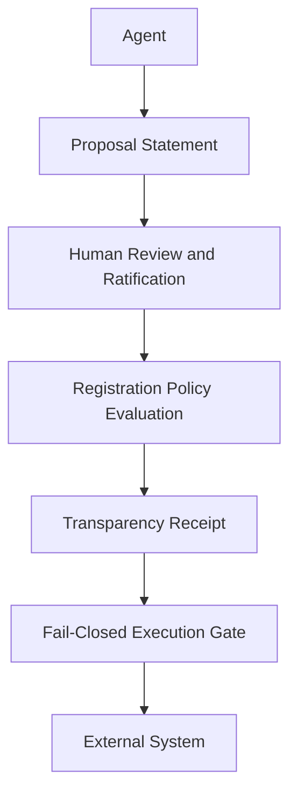

# Sovereign Acceptance Runtime: Verifiable Human Ratification and Evidentiary Audit Trails for Autonomous AI Agents under the EU AI Act

**Working Paper v1.2** (revises v1.1, doi:10.5281/zenodo.23270905; see "Revision Notes" at the end)  
**Date:** October 2026  
**Author:** Alen Mikulić, Independent Researcher, Zagreb, Croatia  
**Status:** Preprint · DOI: [10.5281/zenodo.23280006](https://doi.org/10.5281/zenodo.23280006)  

## Abstract

Autonomous AI agents are rapidly evolving from conversational assistants into software systems capable of invoking external services, modifying persistent state, and executing transactions with real-world consequences. While contemporary agent frameworks frequently incorporate human-in-the-loop (HITL) approval workflows, these mechanisms typically provide operational control without generating portable, cryptographically verifiable evidence of who authorized an action, which execution payload was reviewed, and whether the executed action remained identical to the approved one.

The regulatory significance of this limitation has increased with Regulation (EU) 2024/1689 (the EU AI Act) [1]. Under Article 113 as amended by Regulation (EU) 2026/1744 (the Digital Omnibus on AI) [2], high-risk AI systems become subject to mandatory requirements for automatic event logging, technically implemented human oversight, and operational log retention from 2 December 2027 (systems listed in Annex III) and 2 August 2028 (systems covered by Annex I Union harmonisation legislation). Although these obligations establish regulatory objectives, neither the Regulation nor currently available technical standards specify how authorization records should acquire independent evidentiary value or cryptographic resistance to undetected modification. This creates an architectural gap between regulatory requirements and implementation guidance.

This paper introduces the Sovereign Acceptance Runtime (SAR), an execution architecture that models human authorization as a cryptographically verifiable ratification bound to the exact execution payload. A ratification in this sense proves that an authorized overseer's key signed a statement bound to that payload; it does not by itself prove that a human saw, understood or intended the action (Section 3.8). Concurrent IETF Internet-Drafts already define pre-execution authorization records and human-signed action approvals; SAR's contribution is their composition into a single profile. Building upon the IETF Supply Chain Integrity, Transparency, and Trust (SCITT) architecture (RFC 9943) [3] and CBOR Object Signing and Encryption (COSE) signed statements, SAR represents authorization as a machine-enforceable Registration Policy evaluated before execution. The runtime adopts a fail-closed execution model in which actions proceed only when accompanied by verifiable authorization evidence whose payload binding remains valid at the moment of execution.

The paper develops a threat model and six architectural requirements for verifiable human ratification, states the trusted components and the enforcement boundary the architecture depends on, describes a reference architecture implementing these requirements, positions the work against concurrent IETF drafts and related systems, relates the proposed mechanisms and their limits to selected provisions of the EU AI Act, and evaluates a reference implementation using COSE_Sign1 and deterministic CBOR. The evaluation uses a conformance suite whose adequacy is checked by mutation analysis and by a second implementation. That implementation was written from the paper's Sections 3–4 (v1.1) plus a fixed wire-format specification, by a separate instance of the same AI assistant without access to the reference implementation, and was amended afterwards. The evaluation also covers revocation, crash behaviour and rollback of the authorization store. Finally, the paper outlines a potential path toward interoperability within the IETF SCITT ecosystem.

## 1. Introduction

Artificial intelligence systems are undergoing a transition from passive conversational interfaces toward autonomous software components capable of acting directly upon external environments. Modern AI agents no longer operate exclusively by generating information for human interpretation; they increasingly invoke application programming interfaces (APIs), modify persistent data stores, orchestrate infrastructure, execute administrative workflows, and initiate financial or operational transactions.

This evolution fundamentally changes the security and governance problem surrounding AI deployment. When autonomous systems become capable of producing irreversible external effects, human authorization can no longer be treated merely as a user-interface interaction. Instead, authorization itself becomes a security artifact whose authenticity, integrity, and evidentiary value determine whether an autonomous action should be permitted to occur.

Most existing human-in-the-loop (HITL) mechanisms successfully provide operational oversight by pausing execution until a human approves or rejects an intended action. However, approval is commonly represented as transient application state rather than as independently verifiable cryptographic evidence. Once execution resumes, conventional systems typically retain only mutable audit logs or workflow records describing that an approval occurred. Such records generally do not provide transferable evidence demonstrating who approved the action, what exact payload was reviewed, whether the executed payload remained identical to the approved payload, or whether the authorization can later be verified independently of the original runtime.

This limitation has become increasingly relevant in regulated environments. Regulation (EU) 2024/1689 [1] establishes mandatory obligations for high-risk AI systems. As amended by Regulation (EU) 2026/1744 [2], these obligations apply from 2 December 2027 for systems listed in Annex III and from 2 August 2028 for systems covered by Annex I; the transparency obligations of Article 50 apply from 2 August 2026, except that providers of generative AI systems placed on the market before that date have until 2 December 2026 to comply with Article 50(2) (Article 111(4), added by [2, Art. 1(39)]). Among these obligations are automatic recording of operational events, technically implemented human oversight, and minimum retention periods for operational records. These provisions define regulatory objectives while remaining largely technology-neutral. They do not prescribe specific cryptographic mechanisms through which authorization events become independently verifiable or acquire evidentiary value suitable for regulatory review, forensic investigation, or third-party audit. At the time of writing, harmonized technical standards addressing AI logging and human oversight remain under development (the amending Regulation itself cites the delayed availability of standards as a reason for the deferral [2, Recital 40]), leaving implementers without a standardized architecture for producing verifiable authorization evidence.

This paper proposes the Sovereign Acceptance Runtime (SAR) to address that architectural gap. Rather than treating authorization as an ephemeral workflow event, SAR models human ratification as a signed cryptographic statement evaluated before execution. Authorization becomes a first-class protocol object bound to the exact execution payload and validated through a machine-enforceable Registration Policy before any protected action is permitted to proceed. Successful authorization produces portable cryptographic evidence that remains independently verifiable after execution, while unsuccessful verification results in deterministic denial of execution according to a fail-closed execution model.

The architecture intentionally builds upon existing Internet standards rather than introducing proprietary cryptographic primitives. Human ratification is represented using COSE signed statements, transparency evidence is provided through SCITT-compatible transparency services, and authorization semantics are expressed through Registration Policies evaluated before ledger registration. This separation allows the proposed architecture to reuse established cryptographic building blocks while introducing new semantics governing autonomous execution.

### 1.1 Research Objective

The objective of this work is to investigate whether existing transparency and signing technologies can be combined into an execution architecture in which human authorization becomes independently verifiable, cryptographically bound to the executed payload, and portable across organizational trust boundaries.

Rather than proposing a new digital signature algorithm or transparency mechanism, the paper investigates how existing standards may be composed to produce authorization evidence suitable for autonomous AI systems operating in regulated environments.

### 1.2 Research Contributions

This paper makes four principal contributions.

*   **C1. Threat and Requirements Model.** It develops an adversarial threat model for autonomous AI execution and derives six architectural requirements governing verifiable human ratification.
*   **C2. Sovereign Acceptance Runtime.** It proposes an execution architecture that combines SCITT transparency services, COSE signed statements, and policy-governed authorization into a deterministic fail-closed execution pipeline. Individual elements of this pipeline appear in concurrent Internet-Drafts and related systems (Sections 2.6 and 2.8); the contribution is their composition within SCITT, in particular the use of the SCITT Registration Policy as the pre-execution authorization gate for human ratifications. This element is specified but not yet implemented (Section 6.2).
*   **C3. Reference Implementation and Evaluation.** It provides a reference implementation of the core authorization path and a conformance suite of 137 tests. The suite's adequacy is checked by mutation analysis (37 hand-written and 20 externally contributed semantic mutants, and an automated sweep) and by a second implementation written from the paper and a fixed wire-format specification by a separate instance of the same AI assistant (Section 6.2). The comparison resolved the specification's ambiguities into normative rules (Section 4.17). The evaluation also tests revocation, crash behaviour and rollback of the authorization store. Transparency Service integration is not yet implemented (Section 6).
*   **C4. Standards Pathway.** It outlines a potential interoperability path positioning SAR as an application profile built upon existing IETF technologies rather than as a standalone authorization protocol.

### 1.3 Truth-State Convention

To distinguish architectural intent from implementation maturity, technical claims throughout this paper are explicitly classified according to one of three implementation states.

*   **[Specified]** — fully defined within the architectural model but not completely implemented.
*   **[Partially Enforced]** — implemented within software components while requiring broader operational validation.
*   **[Proven]** — demonstrated within the reference implementation through automated verification of the claimed behavior.

A tag attaches to a mechanism or property as stated. Where a requirement (Section 3.5) or a regulatory row (Section 5.2) combines several mechanisms, it carries the weakest tag among them, so that the same mechanism carries the same tag in Sections 3.5, 4, 5.2 and 6.6. All tags describe the reference implementation of Section 6; a [Proven] tag also presupposes the trusted components and the enforcement boundary of Section 3.8.

### 1.4 Scope

The Sovereign Acceptance Runtime represents one possible technical architecture for producing verifiable authorization evidence for autonomous AI systems. It is not presented as the only implementation capable of supporting the evidentiary objectives discussed, nor as a normative interpretation of Regulation (EU) 2024/1689. Questions of legal compliance remain subject to applicable legislation, future harmonized standards, deployment context, and competent supervisory authorities.

### 1.5 Paper Organization

The remainder of this paper is organized as follows. Section 2 reviews the regulatory background, relevant Internet standards, related systems, concurrent work on agent authorization, and established authorization mechanisms. Section 3 develops the threat model, derives the architectural requirements, and states the trusted components and enforcement boundary. Section 4 presents the Sovereign Acceptance Runtime architecture and authorization protocol. Section 5 relates the proposed mechanisms to selected provisions of the EU AI Act. Section 6 evaluates a reference implementation against a conformance suite. Section 7 discusses a possible standardization pathway. Section 8 examines limitations and future research directions. Section 9 concludes.

## 2. Background and Related Work

### 2.1 Regulatory Context

Regulation (EU) 2024/1689 [1] establishes a risk-based regulatory framework for artificial intelligence systems deployed within the European Union. For high-risk AI systems, the Regulation introduces legally binding obligations concerning lifecycle traceability, human oversight, technical documentation, and operational accountability.

Among the provisions most relevant to autonomous AI agents are the requirements for automatic recording of operational events (Article 12), technically implemented human oversight (Article 14), and retention of operational records by providers and deployers (Articles 19 and 26). These obligations (Chapter III, Sections 2 and 3) apply to high-risk AI systems from 2 December 2027 for Annex III systems and from 2 August 2028 for Annex I systems (Article 113, third paragraph, point (c), as amended by Regulation (EU) 2026/1744 [2]). The original Regulation had set 2 August 2026 for Annex III systems; the deferral was motivated in part by the delayed availability of harmonised standards [2, Recital 40]. The Regulation's penalty provisions (Chapter XII) have applied since 2 August 2025, with the exception of Article 101 [1, Art. 113].

Importantly, the Regulation specifies regulatory objectives rather than implementation mechanisms. It requires that operational events be recorded and that meaningful human oversight be technically supported, but it does not prescribe how authorization events should be represented cryptographically or how evidentiary integrity should be established.

At the time of writing, European harmonized standards addressing AI logging and human oversight remain under development. Draft efforts within CEN/CENELEC and ISO/IEC concerning AI system event recording and oversight provide important direction but do not yet define interoperable mechanisms for producing independently verifiable authorization evidence.

Consequently, implementers face a gap between regulatory obligations and technical realization. This paper addresses that gap from an architectural perspective.

### 2.2 Supply Chain Integrity, Transparency, and Trust (SCITT)

The Internet Engineering Task Force (IETF) Supply Chain Integrity, Transparency, and Trust (SCITT) Working Group develops interoperable mechanisms for publishing, registering, and verifying signed claims within transparency services. The SCITT architecture was published as a Standards Track RFC in June 2026 (RFC 9943 [3]); terminology in this paper (Signed Statement, Transparency Service, Receipt, Registration Policy) follows that document.

Rather than defining a particular transparency ledger implementation, SCITT specifies architectural components enabling independently verifiable provenance across organizational trust boundaries.

The architecture revolves around four principal concepts:
*   **Signed Statements**, represented as cryptographically signed assertions describing an object or event.
*   **Transparency Services**, responsible for evaluating submitted statements against Registration Policies before committing accepted statements to an append-only transparency log.
*   **Receipts**, providing cryptographic evidence that a submitted statement has been accepted and registered.
*   **Independent Verification**, allowing third parties to validate registered statements without trusting the original issuer.

SCITT deliberately remains application-neutral. It standardizes mechanisms for transparency and verification while leaving application-specific semantics—including authorization workflows—outside its scope.

The architecture proposed in this paper builds upon this extensibility rather than modifying the underlying SCITT model.

### 2.3 COSE and CBOR

SAR relies upon existing IETF cryptographic standards for representing signed authorization objects.

The Concise Binary Object Representation (CBOR) (RFC 8949 [4]) provides a compact binary encoding suitable for structured protocol objects; its deterministic encoding rules (Section 4.2) are relied upon in Section 4.4.

CBOR Object Signing and Encryption (COSE) (RFC 9052 [5], RFC 9053 [6]) defines interoperable formats for digital signatures, message authentication, and encryption over CBOR objects. RFC 9864 [7] deprecates polymorphic algorithm identifiers such as EdDSA in favour of fully specified ones; a SAR profile using Ed25519 should therefore use the fully specified Ed25519 identifier.

Within SAR, COSE signatures are used to bind both agent proposals and human ratifications to deterministic payload representations. Because SAR reuses existing standards rather than introducing new cryptographic formats, the proposed architecture remains compatible with established verification libraries and future interoperability efforts.

### 2.4 Human Oversight in Contemporary Agent Frameworks

Current AI agent frameworks increasingly expose mechanisms allowing users to review and approve actions before execution. These approval workflows typically provide:
*   execution pausing,
*   confirmation dialogs,
*   user approval callbacks,
*   policy gating,
*   resumable execution.

Such mechanisms successfully coordinate operational workflows and improve user control. However, they generally treat authorization as transient runtime state. After execution resumes, approval commonly survives only as mutable application state or conventional audit records.

Consequently, existing workflows usually do not generate portable cryptographic artifacts capable of demonstrating:
*   who approved an action;
*   which exact payload was reviewed;
*   whether execution matched the approved payload;
*   whether authorization can later be independently verified.

Accordingly, current human-in-the-loop mechanisms primarily address operational governance rather than evidentiary authorization.

### 2.5 Related Systems

Several existing technologies address adjacent aspects of integrity, provenance, or governance.

*   **Sigstore** [22] provides transparency-backed signatures for software artifacts, enabling independent verification of software origin and integrity.
*   **in-toto** [21] records software supply-chain steps through signed attestations that verify whether software artifacts followed expected production workflows.
*   **SCITT** [3] generalizes transparency services for signed claims across multiple application domains.
*   **Remote attestation (RATS)** [20] lets a verifier appraise evidence about the state of a target environment. It attests to system state rather than to a human decision over a specific action.
*   **Enterprise governance platforms** similarly provide approval workflows, policy engines, and trusted execution mechanisms supporting operational control.

These systems demonstrate mature approaches to software provenance, integrity, and governance. However, their primary objective differs from that considered in this paper. Rather than producing portable authorization evidence governing autonomous execution before an action occurs, they focus on software supply-chain integrity, infrastructure governance, or operational workflow management.

### 2.6 Concurrent Work on Agent Authorization Records

Since early 2026, several individual Internet-Drafts have addressed the evidentiary gap for AI agent actions directly. They are individual submissions, not IETF consensus documents, and are cited here as work in progress. Several of them predate the first version of this paper, and the elements they define overlap substantially with SAR.

*   **Pre-execution permits bound to request bytes.** Munoz [8] (first posted May 2026) defines a SCITT profile for pre-execution AI action authorization records ("Permits"), committing a SHA-256 digest over the canonical wire-body bytes of the request to be dispatched. The issuer of a Permit is not specified to be a human. Enforcement is fail-closed only where dispatch transits a managed proxy, and registration APIs are out of scope. The draft states that no COSE_Sign1 envelope is emitted by the current implementation.
*   **Human-signed approval of the exact action.** Schrock [9] (first posted June 2026) defines authorization receipts in which, before an irreversible action executes, an enrolled approver signs the exact action with an approver-held key; a denial is also signed. A companion draft [10] defines how named-human authorization evidence, including multi-approver quorum, is bound into agent-action records. Neither maps its mechanism to the EU AI Act or uses a SCITT Registration Policy as the gate.
*   **Agent-to-human countersignature.** Kumaresan [11] (first posted July 2026) defines a protocol in which an agent emits an Intent and keyed approvers return signed approve or reject Countersignatures bound to it, with quorum and veto rules; a relying party must not act on an Intent that has not resolved to authorized. It does not use COSE or SCITT.
*   **Post-hoc action records.** The Agent Action Capsule profile [12] records a capsule for every verdict, including refusals, as evidence that a gate worked, and defers the pre-execution permission question to permit profiles. Delegation receipts [13] bind a user's signature primarily to a scope of permitted agent actions; revision -10 also defines a Micro-Receipt for a single action outside that scope (a revision -11, retitled "Agent Delegation Receipts", appeared on 9 October 2026). Further SCITT profiles define agent execution records mapped to AI Act Articles 12 and 19 [14], whose Transparency Service must enforce a Registration Policy that rejects non-conforming post-execution records, and per-action receipts [15]. The Human Escalation Mechanism [16] holds an agent session until a human decides, records that decision with an Ed25519 signature, and maps its mechanism to Article 14. A domain profile for the Operating Model Protocol maps the decision logging of high-risk AI systems to Article 12 and routes policy non-compliance to human oversight with reference to Article 14(4) [17].
*   **Human authority bound into enforcement and evidence.** Morrison, Whiteside and Schrock [24] define a profile for operational-technology control actions in which an enforcement point must refuse an agent-originated action whose required bindings are missing, expired, revoked or unverifiable, and in which the action record is a SCITT Signed Statement that references the human authorization artefact by digest. Das [25] specifies a HumanApproval object that binds an approver, a decision and a signature to a Candidate digest, maps the design to Articles 12, 14 and 26, and argues that a transparency receipt "does not by itself determine" whether an act should execute. Gomes Marques [26] defines post-hoc compliance receipts mapped to Articles 12, 19 and 26.
*   **Certificate-bound admission and signed mandates.** He and Yu [18] describe the Sovereign Assurance Boundary (SAB), in which an agent proposal is compiled into a typed execution contract, bound to an evidence digest and a policy version, routed through a consequence-dependent certification path and executed only by a broker that verifies the resulting signed certificate and its revocation state immediately before mutating the target system. On high-consequence paths the certificate includes human multi-signatures; the authors describe SAB as a boundary that "cryptographically binds human signatures to specific contracts and evidence snapshots". SAB assumes that infrastructure APIs accept mutations only from the broker. It does not use COSE or SCITT and does not map to the AI Act. Despite the similar name, SAB and SAR are unrelated. Racioppi [19] enforces mandates signed by a principal (a natural or legal person or an organizational role) on AI-agent tool calls, including an oversight class that requires synchronous human confirmation of an individual call, with hash-chained audit trails and an explicit mapping to Articles 12 and 14.

### 2.7 Architectural Gap

Taken together, existing standards, concurrent drafts and related systems establish the individual building blocks: signed statements and transparency services [3]; pre-execution authorization records bound to request bytes [8]; human signatures over the exact action, including signed denials [9, 11]; human signatures bound to a typed execution contract and verified by a broker before execution [18]; normative refusal at an enforcement point when human-authorization bindings are missing [10, 11, 16, 24]; refusal records as audit evidence [9, 12]; a Transparency Service Registration Policy used as admission control for post-execution records [14]; and partial mappings to Articles 12, 14, 19 and 26 [14, 16, 17, 19, 25, 26].

Fail-closed execution gated on verified human-authorization evidence is therefore not new in itself [11, 18, 24], and neither is binding a human signature to a digest of the action [9, 18, 25]. To the author's knowledge, as of 10 October 2026 no existing specification composes these elements within SCITT in the following way:
*   a human ratification is itself a COSE-signed SCITT Signed Statement bound to the digest of the exact canonical execution payload (in [24] the SCITT statement records the action and references the human authorization by digest; in [18] the human signatures are not SCITT statements);
*   the SCITT Registration Policy evaluated by the Transparency Service serves as the pre-execution authorization gate, so that a Receipt is issued only for authorized actions and execution is gated on that Receipt (the Registration Policy of [14] admits post-execution records, and [25] argues that a transparency receipt alone should not decide execution);
*   the resulting evidence is related explicitly to Articles 12, 14, 19 and 26 of the EU AI Act together ([25] covers Articles 12, 14 and 26; [26] Articles 12, 19 and 26).

The second element is the one SAR adds to the drafts; it is specified in Section 4 but not implemented in this paper (Section 6.2). The Sovereign Acceptance Runtime is intended to complement the drafts above rather than compete with them; Section 7 discusses alignment.

### 2.8 Relation to Capability-Based Security and Established Authorization Protocols

Several established mechanisms address parts of the same problem outside the AI-agent setting.

*   **Capabilities.** In capability-based security [27], possession of an unforgeable token designating an object and the operations permitted on it is the authority to perform those operations. A SAR authorization behaves like a single-use capability for exactly one payload: it designates the action by digest, is consumed on use (Section 4.10), and is useless for any other payload. It differs in how it is created: it is minted only by a quorum of human signatures under a policy, and it is meant to remain verifiable as evidence after it has been used. Capability systems also rest on the premise that the protected object cannot be reached except through a capability; SAR inherits the same premise as its enforcement boundary (Section 3.8).
*   **OAuth 2.0 Rich Authorization Requests.** RFC 9396 [28] lets a client request fine-grained authorization, for example a payment of a given amount to a given payee, which the resource owner approves and which is then carried in an access token. The approval is recorded by the authorization server; the resource owner does not sign the action, and the token is not designed as portable third-party evidence of the human decision.
*   **Dynamic linking in payment authentication.** The regulatory technical standards for strong customer authentication under the second Payment Services Directive [29, Art. 5] require that the authentication code be specific to the amount and the payee, and that any change to the amount or the payee invalidate it. This is payload-bound human authorization in a regulated setting. The code is verified by the payment service provider; it is not designed for independent verification by third parties or for composition into a transparency log.

SAR's specific contribution relative to these is therefore narrow: portable, independently verifiable evidence of a quorum of human ratifications over an exact canonical payload, enforced at a fail-closed gate and, in the full architecture, registered under a SCITT Registration Policy.

## 3. Threat Model and Architectural Requirements

### 3.1 Security Objectives

The Sovereign Acceptance Runtime (SAR) is intended to ensure that autonomous actions executed by AI agents remain subject to cryptographically verifiable human authorization. Rather than treating approval as transient workflow state, the architecture seeks to establish durable authorization evidence that remains independently verifiable after execution.

The design is guided by five primary security objectives.

*   **O1. Authorization Authenticity:** Every authorized action shall be attributable to an authenticated human overseer possessing an authorized signing credential.
*   **O2. Authorization Integrity:** The authorization decision shall remain cryptographically bound to the exact payload reviewed by the human overseer.
*   **O3. Evidence Portability:** Authorization evidence shall remain independently verifiable without requiring continued access to the original runtime environment.
*   **O4. Execution Integrity:** Protected actions shall execute only after successful verification of all required authorization evidence.
*   **O5. Audit Verifiability:** Independent auditors shall be capable of reconstructing and verifying the authorization chain using only published cryptographic artifacts.

These objectives define the security properties that the proposed architecture seeks to achieve and motivate the threat model described below.

### 3.2 Trust Model

The architecture involves four principal actors.

*   **Agent (A):** An autonomous software component responsible for proposing actions. The agent is not inherently trusted.
*   **Sovereign Overseer (S):** An authorized human responsible for reviewing proposed actions and issuing cryptographic ratifications or rejections.
*   **Transparency Service (T):** A SCITT-compatible transparency service responsible for evaluating Registration Policies, recording accepted statements, and issuing cryptographic receipts.
*   **Verifier (V):** An independent auditor, regulator, or third party validating authorization evidence after execution.

The architecture assumes:
*   secure cryptographic primitives;
*   uncompromised signing keys during authorization;
*   correct implementation of signature verification algorithms;
*   an Execution Gate, its authorization store and its clock that run unmodified outside the agent's control, and an enforcement boundary through which every protected operation must pass (Section 3.8).

No assumptions are made regarding:
*   agent behaviour;
*   integrity of the agent's runtime environment;
*   operating system trustworthiness of the hosts running the agent or the overseer's client;
*   administrator honesty, except for whoever controls the Execution Gate, its configuration and the anchor of its store (Section 3.8);
*   network security.

Accordingly, the agent and its runtime are treated as potentially hostile until authorization evidence is successfully verified by the Execution Gate.

### 3.3 Adversary Model

Let $\mathcal{A}$ denote a probabilistic polynomial-time adversary capable of compromising application state, execution environments, communication channels, and operational infrastructure.

The adversary may:
*   modify application memory;
*   manipulate persistent storage;
*   replay previously observed protocol messages;
*   intercept network communication;
*   fabricate application logs;
*   attempt unauthorized action execution.

The adversary is not assumed capable of:
*   breaking standard cryptographic primitives;
*   forging valid signatures without possession of corresponding private keys;
*   violating collision resistance of the selected hash algorithm.

### 3.4 Threats

The architecture considers six principal threats.

*   **T1. Audit Log Modification:** The adversary modifies, deletes, or backdates operational records to conceal unauthorized actions or fabricate compliance evidence.
*   **T2. Authorization Forgery:** The adversary injects fabricated approval events into application state or runtime logs without obtaining a valid sovereign signature.
*   **T3. Authorization Repudiation:** A participant later disputes whether authorization occurred or claims that an observed authorization corresponds to a different action.
*   **T4. Payload Substitution (TOCTOU):** The payload reviewed during authorization differs from the payload ultimately executed. This represents a classical time-of-check to time-of-use (TOCTOU) attack.
*   **T5. Authorization Replay:** Previously valid authorization evidence is reused to authorize additional executions beyond its intended scope.
*   **T6. Transparency Inconsistency:** A compromised transparency service presents inconsistent ledger views to different observers in an attempt to conceal unauthorized registrations.

### 3.5 Architectural Requirements

The identified threats motivate six architectural requirements.

*   **R1. Cryptographic Ratification [Proven]:** Human authorization shall be represented by a cryptographic signature over a deterministic representation of the proposed action.
    *   *Mitigates:* T2; T3 as to which key signed which action (Section 3.8 discusses what a signature does not establish)
*   **R2. Tamper-Evident History [Partially Enforced]:** Operational evidence shall be recorded using append-only cryptographic structures capable of revealing unauthorized modification. (Hash-chained decision log: [Proven] relative to a checkpoint retained outside the database; transparency registration: [Specified].)
    *   *Mitigates:* T1
*   **R3. Portable Authorization Evidence [Partially Enforced]:** Authorization artifacts shall remain independently verifiable without requiring access to the original runtime. (Signed statements: [Proven]; Receipts: [Specified].)
    *   *Mitigates:* T3, T6
*   **R4. Policy-Governed Registration [Partially Enforced]:** Registration shall succeed only after all authorization policies have been satisfied. (Policy evaluated by the Execution Gate, not at a Transparency Service.)
    *   *Mitigates:* T2
*   **R5. Fail-Closed Execution Binding [Proven]:** Execution shall proceed only after successful verification that the runtime payload exactly matches the ratified payload.
    *   *Mitigates:* T4, T5
*   **R6. Transparency Consistency [Specified]:** Registration evidence shall support independent detection of inconsistent transparency views.
    *   *Mitigates:* T6

### 3.6 Threat Coverage

| Threat | Primary Requirement |
| :--- | :--- |
| T1 | R2 |
| T2 | R1, R4 |
| T3 | R1, R3 |
| T4 | R5 |
| T5 | R5 |
| T6 | R3, R6 |

The mapping establishes traceability between the adversarial model and the architectural mechanisms presented in the following section.

### 3.7 Scope of the Threat Model

The following scenarios are explicitly outside the scope of this work:
*   Compromise of the sovereign overseer's private signing key prior to authorization.
*   Failure of standard cryptographic primitives.
*   Physical compromise of hardware security modules.
*   Denial-of-service attacks preventing authorization or receipt issuance.
*   Assessment of whether the human authorization decision itself was substantively correct.

These assumptions are common to many cryptographic authorization systems and represent areas for future investigation rather than objectives of the proposed architecture. Section 3.8 nevertheless states the consequences of key compromise.

### 3.8 Trusted Components and Enforcement Boundary

SAR protects only actions that are routed through the Execution Gate. This section states what the architecture must trust and which guarantees therefore stop at the gate.

**Trusted components.** The Execution Gate, its authorization store (consumed replay keys and decision log), the clock that supplies the evaluation instant, and the source of the Registration Policy are trusted components. They must run outside the agent's control, for example at the relying party (the target system or a broker in front of it) or in an attested environment. The agent must not be able to modify the gate's code, its policy or configuration, its clock or its store. A deployment in which the agent can do any of these is outside what SAR protects. The reference implementation takes the evaluation instant from its caller, so the caller is part of this trusted base.

**Enforcement boundary.** Every protected operation (every tool call or API request that can produce an external effect requiring ratification) must pass through the gate. Bypass resistance is an architectural requirement, not a property of the protocol: the credentials needed to invoke a protected tool must be held by the gate or by an executor behind it, never by the agent, and the protected tool must not be reachable from the agent by any other path. SAB [18] states the same premise as an assumption that infrastructure APIs accept mutations only from its broker. This paper does not demonstrate bypass resistance; it shows only that the gate itself denies everything that is not validly authorized. An unprotected path makes SAR evidence a record of what was authorized, not a guarantee of what was executed.

**Exact bytes.** The gate compares a digest; the executor must then execute exactly the bytes that were digested. If the executor sends a separately held or re-encoded object, payload substitution (T4) is possible again after the check. The reference implementation therefore offers an interface that takes the payload as deterministic CBOR bytes, digests a private copy and returns exactly that copy on ALLOW (Section 4.9). The executor's use of those bytes is a deployment obligation.

**Crash behaviour.** The gate consumes an authorization, atomically with recording the decision, before it returns ALLOW, and the executor acts only afterwards (consume-then-execute). A crash after consumption therefore leaves the authorization consumed but unexecuted; it is never re-enabled, and a retry needs a new proposal and ratification. Execution is at most once, not exactly once (Sections 4.10 and 6.5).

**Rollback of the store.** Replay protection is only as good as the store's integrity. Whoever can replace the database file with an older copy, or delete consumed keys, can re-enable a consumed authorization; Section 6.5 demonstrates this. The reference implementation can therefore be given an anchor: a signed checkpoint retained outside the database, which the gate checks before every ALLOW and advances inside the same transaction. It helps only if the anchor is kept in a trust domain that the attacker on the database cannot also write, for example another host, write-once storage or a transparency log.

**Revocation.** The gate evaluates the policy in force at execution time. Removing an overseer or agent from the policy, or replacing a key, causes denial of every later request that depends on it, including requests ratified before the change (Section 6.5). Offline verification against the earlier policy still succeeds, so an auditor must know which policy applied at the time of execution (Section 4.5.3).

**Key compromise.** A signature proves that a key was used. Whoever holds an authorized overseer key, or a quorum of them, can ratify any proposal from an authorized agent, and the resulting evidence is indistinguishable from a genuine ratification. A compromised agent key lets an attacker submit proposals, but they cannot execute without ratification. Compromise of the store's checkpoint key, or write access to both the store and its anchor, defeats tamper evidence and rollback detection. Compromise of the gate itself defeats everything. Mitigations (hardware-backed keys, threshold signatures, quorums spanning independent people and devices, short validity intervals, revocation and monitoring) reduce these risks but are not evaluated here.

**Cryptographically verifiable ratification versus human-intent assurance.** In this paper, a *cryptographically verifiable ratification* is a statement that (i) is signed with a key that the governing policy attributes to an authorized overseer, (ii) is bound to the digest of one exact canonical execution payload, through the signed proposal, and (iii) can be verified by a third party from the artifacts and the policy's trust anchors alone. It establishes which key approved which payload under which policy, and when the signer said it did so. It does not establish *human-intent assurance*: that a human, rather than software with access to the key, produced the signature; that the person saw a rendering faithful to the signed payload and understood it ("what you see is what you sign", WYSIWYS); that the person was not deceived, coerced or fatigued; or that the key was intact. WYSIWYS and the review interface are outside the scope of this paper. Consequently R1 mitigates repudiation (T3) only as to the use of the key: an overseer can still argue that what was displayed differed from what was signed.

## 4. Sovereign Acceptance Runtime Architecture

### 4.1 Architectural Overview

The Sovereign Acceptance Runtime (SAR) is a deterministic authorization layer positioned between autonomous decision-making and external action execution.

An agent may generate a proposed action, but it may not directly invoke a protected external operation. Before execution, the proposed action must pass through a sequence of cryptographic and policy checks that produce independently verifiable authorization evidence.

SAR separates the execution process into four distinct responsibilities:
1.  **Action proposal**, performed by the autonomous agent.
2.  **Human ratification**, performed by one or more authorized overseers.
3.  **Policy evaluation and evidence registration**, performed by a transparency service.
4.  **Execution authorization**, performed by the Execution Gate immediately before invocation; the gate is a trusted component outside the agent's control (Section 3.8).

This separation prevents authorization from depending solely on mutable application state. Execution instead depends on cryptographic artifacts whose validity can be verified independently of the agent, application database, or user-interface workflow.

The core execution path is:


The architecture does not assume that the agent, its application runtime, operating system, or network environment is trustworthy; it does assume a trusted Execution Gate on the only path to protected operations (Section 3.8). A protected action is authorized only when the execution gate successfully validates the required signatures, policy context, transparency evidence, freshness constraints, and runtime payload binding.

### 4.2 Design Principles

SAR follows five design principles.

#### 4.2.1 Explicit Authority
No protected action is considered authorized unless an identified overseer has issued a valid cryptographic ratification. Silence, absence of rejection, workflow progression, or possession of application state does not constitute authorization.

#### 4.2.2 Deterministic Verification
Authorization decisions must be verifiable through deterministic procedures. Given the same proposal, ratification, policy, receipt, and trust anchors, independent verifiers should reach the same validation result.

#### 4.2.3 Payload-Bound Ratification
Human ratification applies to one deterministic representation of one proposed action. Authorization cannot be transferred to a modified payload without invalidating the cryptographic binding.

#### 4.2.4 Portable Evidence
Authorization evidence should remain verifiable outside the system in which the decision occurred. A regulator, auditor, counterparty, or incident investigator should not need access to the original runtime database to verify the authorization chain.

#### 4.2.5 Fail-Closed Execution
Execution is denied unless every required validation step succeeds. Missing, expired, malformed, unverifiable, or mismatched evidence is treated as authorization failure.

### 4.3 Running Example

To illustrate the architecture, consider an autonomous financial agent preparing a wire transfer.

The intended operation contains:
*   a source account;
*   a destination account;
*   a transfer amount;
*   a currency;
*   a requested execution time;
*   a transaction identifier.

In a conventional approval workflow, the agent may display this information to a human and resume execution after the user selects an approval button. The resulting authorization may survive only as application state or a conventional log record.

Under SAR, the agent first produces a canonical execution payload and a cryptographic Proposal Statement. The overseer reviews the exact canonical payload and signs a Ratification Statement referencing its digest. The proposal and ratification are evaluated against a Registration Policy. If the policy is satisfied, the transparency service registers the evidence and issues a Receipt.

Immediately before the banking API is invoked, the execution gate reconstructs the runtime payload, computes its digest, verifies the Receipt and ratification, and confirms that the runtime digest matches the ratified digest. The transfer proceeds only if every verification succeeds.

Although the example uses a financial transaction, the same model applies to infrastructure changes, access-control operations, industrial commands, healthcare workflows, data disclosure, and other actions requiring accountable human authorization.

### 4.4 Canonical Payload Representation

Cryptographic binding requires a deterministic representation of the proposed action. Let $P$ denote the canonical execution payload. $P$ includes all parameters whose modification could alter the external effect of the action.

For the running example:
```json
P = {
    "action_type": "wire_transfer",
    "source_account": "...",
    "destination_account": "...",
    "amount": 5000,
    "currency": "EUR",
    "execution_time": "...",
    "transaction_id": "..."
}
```

The payload is encoded using deterministic Concise Binary Object Representation (CBOR) rules. Its digest is computed as:
$$d_P = H(P)$$
where $H$ is a collision-resistant cryptographic hash function, such as SHA-256.

Metadata that can alter execution meaning must be included in $P$. Descriptive fields that do not affect execution may be represented separately, but they must not be allowed to modify the action after ratification.

The security of the payload-binding mechanism depends on the canonical representation being stable. Two semantically identical actions must produce the same encoded representation, while any execution-relevant modification must produce a different digest.

**Status: [Proven]**

### 4.5 Protocol Objects

SAR defines four primary protocol objects:
*   Proposal Statement;
*   Ratification Statement;
*   Registration Policy;
*   Receipt and Transparent Authorization Record.

The notation in this section is illustrative. A future protocol profile would define normative Concise Data Definition Language (CDDL) schemas and validation procedures.

#### 4.5.1 Proposal Statement

A Proposal Statement represents an action that an agent seeks permission to execute. A minimal Proposal Statement contains:
```cddl
ProposalStatement = {
    version: uint,
    proposal_id: text,
    agent_id: text,
    payload_digest: bytes,
    payload_media_type: text,
    action_type: text,
    target: text,
    issued_at: uint,
    expires_at: uint,
    nonce: bytes,
    policy_id: text
}
```

The Proposal Statement is signed by the agent using a COSE Single Signer Data Object (COSE_Sign1). Illustratively:
$$Proposal = \text{COSE\_Sign1}_{K_A}(d_P, \text{metadata})$$
where $K_A$ is the agent signing key, $d_P$ is the digest of the canonical execution payload, and $\text{metadata}$ contains the remaining proposal attributes.

The agent signature does not authorize execution. It identifies the source of the proposal and protects the proposal object from undetected modification.

**Status: [Partially Enforced]** (implemented with a subset of the illustrative fields; Section 6.2)

#### 4.5.2 Ratification Statement

A Ratification Statement records a sovereign overseer's decision regarding a specific Proposal Statement. A minimal Ratification Statement contains:
```cddl
RatificationStatement = {
    version: uint,
    ratification_id: text,
    proposal_digest: bytes,
    proposal_id: text,
    overseer_id: text,
    verdict: text, ; "APPROVED" / "REJECTED"
    reviewed_at: uint,
    valid_until: uint,
    policy_id: text,
    reviewer_context: map
}
```

The verdict field contains an explicit authorization decision (`APPROVED` or `REJECTED`).

The overseer signs the Ratification Statement using COSE_Sign1:
$$Ratification = \text{COSE\_Sign1}_{K_S}(H(Proposal), \text{verdict}, \text{policy\_id})$$
where $K_S$ is the overseer's signing key.

The signature binds the overseer to the exact Proposal Statement rather than to an application-specific approval identifier. A rejection is represented as a signed artifact rather than as the absence of approval. This preserves evidence that human intervention occurred and records the decision that prevented execution.

**Status: [Partially Enforced]** (implemented with a subset of the illustrative fields; Section 6.2)

#### 4.5.3 Registration Policy

A Registration Policy defines the conditions under which the transparency service may register an authorization record. A policy may specify:
```cddl
RegistrationPolicy = {
    policy_id: text,
    policy_version: text,
    authorized_agents: [+ text],
    authorized_overseers: [+ text],
    permitted_action_types: [+ text],
    quorum: uint,
    proposal_validity_window: uint,
    ratification_validity_window: uint,
    replay_constraints: map,
    target_constraints: map,
    contextual_constraints: map
}
```

Typical policy requirements include:
*   the proposal was signed by an authorized agent;
*   the ratification was signed by an authorized overseer;
*   the action type is permitted under the policy;
*   the ratification references the submitted proposal;
*   the required reviewer quorum is satisfied;
*   the proposal and ratification are not expired;
*   the transaction identifier or nonce has not previously been consumed;
*   deployment-specific contextual conditions are satisfied.

The policy is identified by a versioned `policy_id`. Versioning is necessary because an auditor must be able to determine which policy governed an authorization at the time it was registered. The transparency service evaluates the policy before registration. A failed policy evaluation produces no authorization Receipt.

**Status: [Partially Enforced]** (evaluated by the Execution Gate rather than a Transparency Service; only `policy_id`, authorized agents and overseers and quorum are implemented. `policy_version`, policy-defined validity windows, replay constraints, and action-type, target and contextual constraints are not, so validity intervals are bounded only by what the signers chose; Section 6.2)

#### 4.5.4 Receipt and Transparent Authorization Record

When the Registration Policy is satisfied, the transparency service commits the accepted evidence to its append-only structure and issues a cryptographic Receipt.

The Receipt provides evidence that the submitted authorization record was accepted and incorporated into the transparency service. A Transparent Authorization Record consists of:
```cddl
TransparentAuthorizationRecord = {
    proposal: ProposalStatement,
    ratification_set: [+ RatificationStatement],
    registration_policy_reference: text,
    receipt: bytes
}
```

Illustratively:
$$TAR = \langle Proposal, Ratifications, PolicyRef, Receipt \rangle$$

The Receipt is not itself a human approval. It proves that the proposal and ratification evidence were evaluated and registered under the identified policy. A verifier can use the Transparent Authorization Record to validate the authorization chain independently.

**Status: [Specified]**

### 4.6 Authorization Protocol

The SAR authorization protocol consists of five phases.

*   **Phase 1: Proposal Generation**
    The agent constructs the canonical execution payload $P$, computes $d_P = H(P)$, and produces a signed Proposal Statement. The Proposal Statement is assigned a unique `proposal_id`, nonce, validity interval, and policy reference. At this stage, the action remains non-executable.

*   **Phase 2: Human Review and Ratification**
    The overseer receives both:
    *   a human-readable rendering of the intended action;
    *   the canonical payload or a representation cryptographically linked to it.
    The interface must ensure that the reviewed representation corresponds to the payload digest in the Proposal Statement. After review, the overseer issues either a signed Ratification Statement with verdict `APPROVED` or a signed Ratification Statement with verdict `REJECTED`. A policy requiring multiple overseers produces a set of Ratification Statements.

*   **Phase 3: Policy Evaluation**
    The proposal and ratification set are submitted to the transparency service. The service verifies:
    *   proposal signature validity;
    *   ratification signature validity;
    *   proposal-to-ratification binding;
    *   authorized agent and overseer identities;
    *   policy version;
    *   required quorum;
    *   permitted action type;
    *   validity intervals;
    *   nonce or transaction uniqueness;
    *   contextual policy constraints.
    Any validation failure terminates the registration attempt.

*   **Phase 4: Registration and Receipt Issuance**
    If the Registration Policy is satisfied, the transparency service registers the authorization record within its append-only structure. The service then issues a Receipt containing the evidence necessary to verify registration and inclusion. Receipt issuance marks the transition from an approval decision to portable authorization evidence.

*   **Phase 5: Gated Execution**
    Immediately before invoking the external system, the Execution Gate (a trusted component, Section 3.8) receives:
    *   the runtime payload $P_{\text{runtime}}$;
    *   the Proposal Statement;
    *   the required Ratification Statements;
    *   the Registration Policy reference;
    *   the Receipt.
    The gate verifies all authorization evidence and recomputes $d_{\text{runtime}} = H(P_{\text{runtime}})$. Execution is permitted only if:
    $$\text{VerifyReceipt}(Receipt) = \text{TRUE}$$
    $$\text{VerifyProposalSignature}(Proposal) = \text{TRUE}$$
    $$\text{VerifyRatificationSignatures}(Ratifications) = \text{TRUE}$$
    $$\text{EvaluatePolicy}(Proposal, Ratifications, Policy) = \text{TRUE}$$
    $$d_{\text{runtime}} = d_P$$
    $$\text{ReplayCheck}(proposal\_id, nonce, transaction\_id) = \text{PASS}$$
    If any condition fails, execution is denied.

**Status: [Partially Enforced]** (Phase 1 and Phase 5 implemented; Phase 2 implemented as signing only, without a review interface; Phase 3 performed by the Execution Gate; Phase 4, registration and Receipt issuance, not implemented)

### 4.7 Fail-Closed Execution Semantics

Fail-closed execution is the primary runtime enforcement property of SAR. The execution gate begins from the state DENY and transitions to ALLOW only after every mandatory validation succeeds.

The following conditions result in deterministic denial:
*   Missing Proposal Statement;
*   Invalid agent signature;
*   Missing Ratification Statement;
*   Invalid overseer signature;
*   Insufficient approval quorum;
*   Rejected verdict;
*   Expired proposal;
*   Expired ratification;
*   Invalid or unrecognized policy version;
*   Invalid Receipt;
*   Payload digest mismatch;
*   Previously consumed nonce or transaction identifier;
*   Unavailable verification dependency where verification is mandatory.

The runtime does not fall back to application-level approval state if cryptographic verification fails. Timeouts, unavailable transparency evidence, parsing errors, and ambiguous policy results are treated as failures rather than as reasons to proceed. This behavior implements deny-by-default semantics at the boundary where the action acquires external effect.

**Status: [Partially Enforced]** (implemented and tested for all listed conditions except an invalid Receipt, an unrecognized policy version and an unavailable verification dependency). Fail-closed behaviour of the implemented gate on the conditions it does evaluate (invariant I5) is [Proven] (Section 6.6); the [Partially Enforced] tag reflects the conditions that cannot yet arise.

### 4.8 Defense Against Authorization Forgery

Authorization forgery occurs when an attacker attempts to represent an action as approved without obtaining a valid sovereign signature.

SAR requires every approval decision to be encoded within a Ratification Statement signed by a policy-authorized overseer. An application database entry such as `approved = true` does not satisfy the Registration Policy and cannot produce a valid Receipt.

To forge authorization, an attacker would need to forge a valid overseer signature, compromise an authorized signing key, or cause the policy verifier to accept an unauthorized key. Under the cryptographic and trust assumptions in Section 3, a fabricated approval event cannot satisfy the ratification and registration checks. This mechanism directly addresses T2 through R1 and R4.

**Status: [Proven]**

### 4.9 Defense Against Payload Substitution

A time-of-check to time-of-use attack occurs when the payload presented during human review differs from the payload supplied to the external system.

SAR prevents this substitution by using the payload digest as the principal binding value throughout the authorization chain. The overseer ratifies a Proposal Statement containing $d_P$. Immediately before invocation, the execution gate recomputes $d_{\text{runtime}}$ from the actual execution payload.

Execution requires $d_{\text{runtime}} = d_P$, compared over all bytes of the digest. Any modification to an execution-relevant parameter changes the runtime digest and causes the gate to deny execution. For the running example, changing destination account, amount, currency, source account, execution identifier, or any other field included in the canonical payload after approval invalidates the authorization. This mechanism directly addresses T4 through R5.

The comparison protects execution only if the bytes that reach the external system are the bytes that were digested. A gate that returns only a Boolean leaves a window in which the executor may send a different object. The gate should therefore take the payload as its canonical byte string and hand exactly those bytes to the invocation, or the target system should recompute the digest itself (Section 3.8).

**Status: [Proven]** for the gate's comparison and for the exact-bytes interface of the reference implementation; use of the returned bytes by the executor is a deployment obligation (Section 3.8)

### 4.10 Replay Prevention

A valid authorization must not be reusable outside its intended execution context. SAR therefore requires each proposal to contain replay-relevant attributes, including at least:
*   a unique `proposal_id`;
*   a cryptographic nonce;
*   an expiration time;
*   an execution or transaction identifier.

The Registration Policy defines the applicable replay rule. A deployment may require that:
*   each proposal be consumed at most once;
*   each nonce be unique within a policy domain;
*   each transaction identifier map to only one successful execution;
*   authorization expire after a defined validity window;
*   execution occur only at a specified target.

The execution gate records successful consumption of the authorization identifier before invocation, atomically with recording the decision. A subsequent attempt to present the same authorization evidence fails the replay check at any later instant. Because consumption precedes execution, a failure between the two leaves the authorization consumed and unexecuted (at most once). Where exactly-once execution is required, the integration must use idempotency keys or an external transaction protocol appropriate to the target system. Replay protection also depends on the integrity of the store: restoring an older copy of it re-enables consumed authorizations unless the store is checked against a checkpoint retained elsewhere (Section 3.8). This mechanism directly addresses T5 through R5.

**Status: [Proven]** (for gates sharing one authorization store whose integrity is intact, or is checked against an anchor kept in a separate trust domain; Section 6.5)

### 4.11 Rejection and Interruption

A rejection is a signed governance event. When the overseer issues a Ratification Statement with verdict `REJECTED`, the transparency service may register the rejection for audit purposes, but it must not issue an authorization Receipt permitting execution.

A registered rejection provides evidence that a proposal was submitted, a human reviewed the proposal, authorization was explicitly denied, and the runtime was expected to remain in the deny state.

For actions already in progress, SAR distinguishes between pre-execution rejection, runtime interruption, and post-execution remediation. The core protocol governs pre-execution authorization. Runtime interruption requires an integration-specific stop mechanism capable of halting or containing an already initiated process. Accordingly, a signed rejection can authorize or document interruption, but its operational effect depends on the capabilities of the target system.

**Status: [Partially Enforced]** (signed rejection and denial implemented; registration of rejections and runtime interruption not implemented)

### 4.12 Independent Verification

An external verifier receives the Transparent Authorization Record and the relevant trust material. The verifier performs the following procedure:
1.  Parse the Proposal Statement.
2.  Verify the agent signature.
3.  Reconstruct or obtain the canonical payload and confirm its digest.
4.  Parse each Ratification Statement.
5.  Verify each overseer signature.
6.  Confirm that every ratification references the Proposal Statement.
7.  Resolve the applicable Registration Policy and policy version.
8.  Verify that the submitted evidence satisfied the policy.
9.  Verify the Receipt and inclusion evidence.
10. Confirm validity intervals and replay-related identifiers.
11. Compare the registered payload digest with any independently obtained execution record.

The verifier does not need access to the original application database or user-interface state. The resulting verification establishes that a particular proposal and ratification set were registered under the identified policy. Additional execution evidence is required to establish that the external system actually performed the action.

SAR therefore distinguishes authorization evidence (proving execution was permitted) from execution evidence (proving execution occurred). The present architecture focuses primarily on authorization evidence, while allowing execution results to be linked as subsequent transparent statements.

**Status: [Partially Enforced]** (steps 1, 2, 4–6 and 8 implemented, step 7 without policy versioning, and the validity-interval part of step 10; payload reconstruction (step 3), Receipt verification (step 9) and comparison with execution records (step 11) not implemented)

### 4.13 Transparency Consistency

A transparency service may become malicious or compromised and attempt to present different ledger views to different verifiers. SAR relies on transparency mechanisms such as cryptographic inclusion proofs, consistency proofs, signed ledger roots, independent monitoring, and cross-verifier comparison.

A Receipt proves inclusion relative to a specific ledger state. Detection of persistent split views requires verifiers or monitors to compare signed roots or consistency evidence over time. Consequently, transparency receipts reduce dependence on the original runtime, but they do not eliminate the need for transparency monitoring. Requirement R6 is therefore fully specified at the architectural level but depends on deployment of appropriate consistency and monitoring mechanisms.

**Status: [Specified]**

### 4.14 Security Invariants

The security argument for SAR rests on five invariants.

*   **I1. Proposal Uniqueness:** Every protected execution references one canonical Proposal Statement. The proposal identifies the intended payload through its cryptographic digest and replay-resistant identifiers.
*   **I2. Ratification Binding:** Every valid Ratification Statement references one specific Proposal Statement or its digest. A ratification cannot be detached and applied to a different proposal without invalidating verification.
*   **I3. Policy-Validated Registration:** A valid authorization Receipt is issued only after the proposal and ratification evidence satisfy the identified Registration Policy.
*   **I4. Runtime Payload Equality:** Immediately before execution, the digest of the runtime payload must equal the digest contained in the authorized proposal.
*   **I5. Deny-by-Default State:** The execution gate remains in the deny state unless all required verification procedures succeed.

### 4.15 Security Argument

Under the assumptions defined in Section 3, the invariants support the following security claim: A protected autonomous action cannot reach execution through the SAR gate unless valid authorization evidence exists for the exact runtime payload, the applicable Registration Policy is satisfied, and the authorization has not expired or been consumed. The claim covers only actions that pass through the gate; that every protected action does so is the enforcement-boundary assumption of Section 3.8.

The claim follows from these mechanisms:
*   **Authorization forgery:** An attacker without an authorized overseer key cannot produce a valid Ratification Statement satisfying I2 and I3. Fabricated workflow state therefore cannot authorize execution.
*   **Payload substitution:** A substituted payload violates I4 because the recomputed runtime digest differs from the digest in the ratified proposal.
*   **Authorization replay:** Reuse of authorization evidence violates the policy-defined replay constraints enforced under I3 and the execution checks associated with I5.
*   **Log modification:** Modification of registered authorization evidence invalidates signatures, receipts, hash relationships, or consistency proofs.
*   **Repudiation:** The overseer's signed Ratification Statement and associated Receipt provide independently verifiable evidence of the recorded authorization decision, subject to key-management assumptions.
*   **Transparency inconsistency:** Conflicting ledger states may be detected through signed roots, inclusion proofs, consistency proofs, and independent monitoring.

This argument is architectural rather than a formal cryptographic proof. A normative security proof would require a fully specified protocol, formal adversary game, canonical encoding rules, and implementation-independent verification semantics.

### 4.16 Requirement Traceability

| Requirement | Primary SAR Mechanism |
| :--- | :--- |
| **R1. Cryptographic Ratification** | COSE-signed Ratification Statement bound to the Proposal Statement |
| **R2. Tamper-Evident History** | Append-only transparency registration and cryptographic receipts |
| **R3. Portable Authorization Evidence** | Transparent Authorization Record and offline verification |
| **R4. Policy-Governed Registration** | Versioned machine-enforceable Registration Policy |
| **R5. Fail-Closed Execution Binding** | Pre-invocation receipt, signature, replay, and payload-digest verification |
| **R6. Transparency Consistency** | Inclusion proofs, signed roots, consistency evidence, and monitoring |

### 4.17 Resolved Semantics

Sections 4.5–4.12 leave several decisions open: clock tolerance, interval boundaries, duplicate or partially invalid ratification sets, policy well-formedness, replay identifiers and the relationship between gate and audit. A second implementation, written from Sections 3–4 (v1.1) plus a fixed wire-format specification, resolved some of these differently from the reference implementation (Section 6.4). The following rules are therefore normative for this profile. Where a lenient and a strict reading were both possible, the strict reading was chosen, following the fail-closed principle of Section 4.7 and invariant I5. The exception is the clock tolerance of S1, which is a deployment parameter.

Write $\tau$ for the clock tolerance (30 s in the reference implementation). The common interval of a proposal and its ratifications is $[lo, hi)$, where $lo$ is the latest of `issued_at` and all `reviewed_at`, and $hi$ is the earliest of `expires_at` and all `valid_until`.

| Rule | Decision |
| :--- | :--- |
| S1 Clock tolerance | The evaluating clock may run behind the signers' clocks by at most $\tau$: a statement dated up to $\tau$ after the evaluation instant is accepted, one dated later is invalid. |
| S2 Intervals | A proposal is nominally valid on `[issued_at, expires_at)` and a ratification on `[reviewed_at, valid_until)`; empty intervals are invalid. An evaluation at instant $t$ accepts the set iff $lo < hi$ and $lo - \tau \le t < hi$: the tolerance applies to the start only, and expiry is exact. |
| S3 Review window | A ratification must be issued within its proposal's validity: `issued_at <= reviewed_at < expires_at`. |
| S4 Invalid ratifications | Any invalid ratification in the presented set, including an expired one, causes denial; invalid ratifications are not silently ignored. |
| S5 Duplicates | Two ratifications from the same overseer cause denial; quorum counts distinct overseers. |
| S6 Rejection | Any `REJECTED` ratification causes denial, regardless of other approvals. |
| S7 Verdicts | Only `APPROVED` and `REJECTED` are valid verdicts. |
| S8 Policy | A Registration Policy is invalid unless it is well-formed, `1 <= quorum <=` the number of overseers, and roles are separated: no key is registered for two overseers, and no identity or key is both an agent and an overseer. |
| S9 Statement shape | Statements carry exactly the fields of their version. The proposal identifier must equal its recomputation: the first 32 hexadecimal characters (128 bits) of SHA-256 over the deterministic CBOR encoding of the proposal body without the identifier. Identifiers and digests are compared exactly. |
| S10 Replay | An authorization consumes, atomically with the decision record and independently of the presentation time, its proposal identifier, its nonce (unique within the policy) and the payload's top-level `transaction_id`, if present. Identifiers are compared as deterministic CBOR values, so the text `"5"` and the integer 5 are different; nested identifiers are not consumed. A denial consumes nothing. |
| S11 Offline verification | Offline verification uses no clock. It requires everything above that can be checked from the artifacts, plus $lo < hi$. If an evaluation instant $t$ is supplied, it must be accepted by S2. |
| S12 Logging | A failure to record a decision never results in execution. |
| S13 Gate–audit consistency | The gate applies S2 to its own evaluation instant. Hence, apart from replay and payload binding, the gate allows at $t$ if and only if offline verification at $t$ succeeds, and every executed authorization also passes offline verification without an evaluation instant. |

S8 closes a gap that the original text left open. Without it, one person holding a single key registered under two overseer identities could satisfy a quorum of two, and an agent listed as an overseer could ratify its own proposals. Both cases contradict objective O1.

S2 and S13 were revised after an external audit of an earlier draft of this version. That draft stated S2 as `issued_at <= now`, which contradicted the tolerance of S1, and offline verification at the gate's own instant could reject an authorization the gate had allowed. Both implementations now apply the single rule of S2 at the gate and in offline verification.

The reference implementation adds three operational rules that are not decision semantics (Section 3.8): consumption precedes execution (at most once); an interface hands the executor exactly the digested bytes; and the store can optionally be checked against an anchor retained outside it, which detects rollback.

## 5. Architectural Correspondence to the EU AI Act

### 5.1 Scope of the Regulatory Analysis

The objective of this section is not to determine legal compliance with Regulation (EU) 2024/1689 (the EU AI Act), nor to provide legal advice. Rather, it examines the extent to which the architectural mechanisms introduced by the Sovereign Acceptance Runtime (SAR) correspond to selected technical objectives expressed in the Regulation.

The EU AI Act establishes legal obligations while remaining largely technology-neutral. It specifies what high-risk AI systems must achieve but generally does not prescribe how these objectives should be implemented. Consequently, multiple technical architectures may satisfy the same regulatory objective.

SAR is presented as one possible architectural approach for implementing verifiable authorization and evidentiary traceability within autonomous AI systems.

### 5.2 Architectural Correspondence

| EU AI Act Provision | Regulatory Objective | SAR Architectural Mechanism | Implementation State | Limitation: what SAR does not guarantee |
| :------ | :-------- | :---------- | :-------- | :------------------------- |
| Article 12 | Automatic recording of operational events | Proposal Statements, Ratification Statements, Receipts, append-only transparency registration | [Partially Enforced] | Records authorization decisions at the gate, not the system's other operational events. Actions that bypass the gate are not recorded (Section 3.8). Tamper evidence holds only relative to a checkpoint retained outside the store. |
| Article 14 | Technical human oversight | Cryptographic human ratification evaluated before execution | [Partially Enforced] | Shows that an authorized key approved an exact payload. It does not show that the overseer understood the action (cf. Art. 14(4)(a)), did not simply over-rely on the system (automation bias, Art. 14(4)(b)), or was not misled by the rendering (Section 3.8). Effective oversight also depends on the review interface and on organizational measures. |
| Article 14(4) | Human ability to intervene or stop operation | Signed rejection, policy denial, fail-closed execution gate | [Partially Enforced] | Intervention is supported before execution only. Interrupting an action already under way depends on the target system. Revoking an overseer or agent takes effect only for later requests. |
| Article 19 | Provider retention of operational logs | Portable authorization evidence suitable for long-term storage | [Partially Enforced] | Does not retain anything itself or fix a retention period. Long-term verifiability depends on key management, on preserving the policy in force at the time, and on algorithm longevity. |
| Article 26 | Deployer operational accountability and log retention | Verifiable authorization records supporting deployment governance | [Specified] | Does not assign oversight to persons with the necessary competence, training and authority (Art. 26(2)), monitor operation, or fulfil the deployer's other duties. It provides evidence that an authorized person's key approved individual actions. |

The correspondence identifies architectural relationships rather than demonstrating regulatory compliance; the last column is a technical observation, not a legal assessment. Implementation states refer to the reference implementation of Section 6; Receipts and transparency registration are not yet implemented. For high-risk systems, the obligations in Articles 12, 14, 19 and 26 apply from 2 December 2027 (Annex III) and 2 August 2028 (Annex I) [2, Art. 1(40)].

### 5.3 Article 12 – Automatic Event Recording

Article 12 requires high-risk AI systems to record operational events throughout their lifecycle in a manner supporting traceability.

SAR addresses this objective by representing each authorization decision as a sequence of cryptographically related protocol objects: Proposal Statement, Ratification Statement, Registration Policy reference, and Transparency Receipt. Unlike conventional application logs, these artifacts are designed to remain independently verifiable after execution.

Importantly, the Regulation requires automatic recording but does not prescribe append-only transparency structures, cryptographic receipts, or evidentiary verification mechanisms. SAR introduces these architectural mechanisms as one possible implementation strategy rather than as regulatory requirements.

### 5.4 Article 14 – Human Oversight

Article 14 requires that human oversight be technically supported throughout operation of high-risk AI systems. Conventional human-in-the-loop mechanisms typically satisfy this objective by requiring user interaction before execution.

SAR adopts a stronger architectural interpretation in which human authorization becomes a cryptographically verifiable protocol artifact rather than transient workflow state. Within SAR, approval is represented by a signed Ratification Statement, authorization is evaluated before execution, execution depends on successful policy verification, and unsuccessful verification prevents execution through a fail-closed execution gate. Accordingly, oversight becomes an enforceable runtime property rather than solely an interaction pattern.

### 5.5 Article 14(4): Human Intervention

Article 14 further requires that natural persons remain capable of intervening in system operation where appropriate.

SAR distinguishes three forms of intervention: authorization before execution, rejection preventing execution, and interruption mechanisms provided by deployment-specific integrations. The core protocol governs pre-execution authorization. Operational interruption of actions already underway depends on the capabilities of the external system and therefore remains outside the protocol itself. Consequently, SAR supports technical intervention before execution while allowing deployment-specific interruption mechanisms to be incorporated where required.

### 5.6 Articles 19 and 26 – Operational Records

The Regulation requires providers and deployers to retain operational records for defined periods.

SAR does not replace organizational record-retention policies. Instead, it defines portable cryptographic authorization artifacts that may be retained alongside existing operational records. Because Proposal Statements, Ratification Statements, and Receipts remain independently verifiable, they may strengthen the evidentiary quality of retained authorization records without altering the underlying retention obligations.

### 5.7 Relationship to Harmonized Standards

At the time of writing, harmonized technical standards addressing AI logging and human oversight continue to evolve. Current draft work identifies important architectural directions but does not yet define interoperable protocol semantics for cryptographically verifiable human authorization prior to autonomous execution. The deferral of the high-risk obligations to December 2027 and August 2028 [2] leaves a window in which such semantics could mature, both in European standardisation and in the IETF drafts discussed in Section 2.6.

SAR therefore should be viewed as complementary to ongoing standardization efforts rather than as an alternative to them. The proposed architecture intentionally reuses existing Internet standards—including SCITT and COSE—to maximize future interoperability should standardized authorization profiles emerge.

### 5.8 Regulatory Interpretation Boundaries

Several observations should be emphasized:
*   The EU AI Act does not require authorization records to be immutable or stored in transparency ledgers.
*   The Regulation does not prescribe SCITT, COSE, CBOR, Merkle proofs, or any other specific cryptographic technology.
*   Implementing SAR alone does not establish compliance with Regulation (EU) 2024/1689.

Compliance ultimately depends upon the complete AI system, organizational governance, applicable harmonized standards, sector-specific regulation, and the assessment of competent supervisory authorities. Accordingly, the contribution of SAR is architectural rather than legal.

### 5.9 Summary

The analysis presented in this section demonstrates that the mechanisms introduced by the Sovereign Acceptance Runtime correspond to several technical objectives expressed in the EU AI Act while remaining independent of any particular legal interpretation.

Rather than implementing the Regulation itself, SAR illustrates how existing transparency and signing technologies may be composed into an execution architecture capable of producing portable, cryptographically verifiable authorization evidence. This distinction preserves both technical neutrality and regulatory flexibility while providing a concrete foundation for the implementation of accountable autonomous AI systems.

## 6. Reference Implementation and Evaluation

### 6.1 Evaluation Objectives

The reference implementation is not intended to demonstrate production readiness. Its purpose is to establish whether the core authorization architecture of Section 4 can be realized in software while preserving the security properties of Section 3, and to make every implementation claim in this paper testable by third parties. The evaluation addresses three research questions:
*   **RQ1.** Can protected actions be prevented from executing unless valid authorization evidence is presented?
*   **RQ2.** Can modification of the execution payload after human ratification be detected before execution?
*   **RQ3.** Can authorization evidence be verified independently of the runtime that generated it?

### 6.2 Implementations

**Reference implementation.** *sar-cose* [23] is a single Python module of about 740 lines, including about 40 lines of hooks for the hand-written mutants. It depends only on the `cbor2` and `cryptography` libraries.
*   **Statements.** Proposal and Ratification Statements are tagged COSE_Sign1 objects [5]. The protected header carries the algorithm, a content type (distinct for proposals and ratifications) and the signer's key identifier; unprotected header parameters are rejected.
*   **Encoding.** Payloads use the core deterministic CBOR encoding [4, Section 4.2.1]. The encoder is checked against the examples in Appendix A of [4], and the decoder rejects any input not in deterministic form.
*   **Signatures.** Signatures use Ed25519 under the fully specified algorithm identifier −19 [7]; the deprecated polymorphic identifier −8 is rejected by default.
*   **Binding.** The payload digest is SHA-256 over the deterministic encoding. A ratification binds to the SHA-256 digest of the exact COSE_Sign1 bytes of the proposal.
*   **Execution Gate.** The gate implements rules S1–S13 of Section 4.17. In particular it verifies both statement types, enforces separation of roles in the policy, denies on any invalid, expired, duplicate or rejecting ratification, compares the runtime payload digest with the ratified one, and applies the time rule S2 to its evaluation instant, so that it allows at an instant exactly when offline verification at that instant succeeds. It then consumes the proposal identifier, nonce and any transaction identifier atomically with recording the decision. Every failure, including malformed input or a failure to log, results in denial. The policy is read on every request, so revocation takes effect immediately. A second entry point takes the payload as deterministic CBOR bytes and returns exactly those bytes on ALLOW (Section 4.9). The evaluation instant is supplied by the caller (Section 3.8).
*   **Authorization Store.** The store is an SQLite hash chain of decisions. Its head is signed as a checkpoint after every commit with a key that can be kept across restarts. A checkpoint retained outside the database detects later truncation or rewriting by anyone with write access to the database file. Writers take the database write lock before reading the chain tip, so several gates may share one database. Optionally, the store is given an anchor, a checkpoint retained outside it. Before every ALLOW it then verifies the chain against the anchor and the replay keys against the chained ALLOW records, and it advances the anchor before committing (Section 3.8). This check costs time linear in the length of the log.
*   **Offline verification.** A stateless verifier checks, without a clock, that a set of artifacts constitutes a valid authorization under a given policy (rule S11), optionally at a given instant under the same rule as the gate.

**Second implementation.** To test whether the reference implementation and its tests merely share their author's reading of the specification, a second implementation (*sar_indep*, about 640 lines) was written by a separate instance of the same AI assistant, without access to the reference implementation or its tests. Its sources were Sections 3 and 4.4–4.15 of the paper in version 1.1, the original 12-scenario harness, and a fixed wire-format and interface specification. That specification goes beyond Section 4.5: it fixes field names, header labels, content types, the binding digest and the derivation of the proposal identifier, so that the two implementations can exchange artifacts. It is published verbatim with the code. The implementation records 24 interpretation decisions. It was amended once after the comparison (its clock tolerance was raised from 0 to 30 s to follow S1) and, in this revision, once more to follow the revised S2 in offline verification. The blind version is not preserved in version control; it is reconstructed in the repository by reverting the documented amendments. Section 6.4 reports what the comparison found.

**Not implemented:**
*   registration with a SCITT Transparency Service, and issuance and verification of Receipts and inclusion proofs (Sections 4.5.4, 4.6 Phase 4, 4.13): Registration Policy evaluation currently runs inside the gate;
*   publication of checkpoints: the implementation produces signed checkpoints, but where they are retained is left to the deployment;
*   the full field set of the illustrative CDDL in Section 4.5 (for example `payload_media_type`, `target`, `reviewer_context`), and the policy fields `policy_version`, validity windows, replay constraints and action-type, target and contextual constraints;
*   a trusted time source: the evaluation instant is supplied by the caller;
*   bypass resistance: nothing in the implementation prevents a protected tool from being called without the gate (Section 3.8).

### 6.3 Test Suite

The reference implementation is evaluated against 137 automated tests in six groups:

| Group | Tests | Content |
| :--- | ---: | :--- |
| Original scenarios | 12 | The scenarios of the original evaluation (authorized, missing authorization, invalid signature, rejected, modified payload, replay, expired proposal, expired ratification, invalid policy), offline verification, tamper evidence and quorum. Written before the implementation and used unmodified. |
| Gap tests | 11 | Defects the original scenarios did not detect: future-dated or out-of-window ratifications, offline verification of incomplete records, log truncation, duplicate overseers, policy binding, and approvals moved to another proposal. |
| COSE and CBOR | 16 | Appendix A vectors of [4], COSE_Sign1 structure, algorithm, key-identifier and content-type confusion, protected-header tampering, non-deterministic encodings, and verification across libraries in both directions with `pycose`. Because `pycose` does not implement −19, those checks use −8, which the gate itself rejects. |
| Property-based and system | 19 | Differential testing against a reference model, equivalence of gate and offline verification at every interval bound, single-bit flips, payload mutation, encoding properties, exact time boundaries, and concurrency with threads and with separate processes (Section 6.5). |
| Hardening | 75 | One or more tests per rule of Section 4.17, paths found unexercised by coverage analysis, external checkpoints, tests added for survivors of the automated mutation sweep and of an external audit (Section 6.4), revocation, rollback of the store with and without an anchor, crash injection at every database statement, and the exact-bytes interface. |
| Cross-implementation | 4 | Byte-identical artifacts, identical decisions, and the gate/offline equivalence in both implementations (Section 6.5). |

The second implementation passes the original 12 scenarios unmodified and its own 86 tests, and so does the reconstructed blind version. Of the 11 gap tests the second implementation fails one, C10b (log truncation), because it keeps no signed checkpoint; its author recorded this as a known limitation.

### 6.4 Adequacy of the Tests

A passing test suite is evidence for a property only if the suite would fail without the mechanism that provides it. Three methods were used to check this.

**Hand-written mutants.** The implementation exposes 37 mutants, each disabling or weakening exactly one guard. **All 37 are killed**: with any one of them applied, at least one test fails.

**Automated mutation sweep.** A tool mutates every comparison, Boolean operator, condition, constant, return value and statement of the implementation, and runs the full suite against each mutant.
*   **First sweep:** 61 of 325 mutants survived, against the earlier code and suite (raw output not preserved).
*   **Final sweep:** 476 of 491 mutants were killed (96.9%).

Every surviving mutant was examined. Those that revealed missing tests led to new tests. The remainder are argued to be equivalent in their decisions: unreachable code, checks implied by other rules, or code whose effect the tests cannot observe (for example, deleting a `return None` at the end of a function). For some of them the reason given for a denial may differ. Each such argument is in the repository so that it can be attacked.

**External semantic mutants.** An adversarial audit of an earlier draft of this version wrote 20 further semantic mutants by hand. Seven of them survived the suite of that draft. Two were security-relevant: a replay key that included the presentation time, so the same authorization was allowed again one second later, and a payload-digest comparison over only the first 8 bytes. A third, non-atomic consumption of replay keys, was caught only intermittently, by the concurrency test. Tests were added for every survivor. Crash injection at every database statement now detects the non-atomic variant deterministically. All 20 audit mutants are now killed. The seven survivors were also added to the hand-written mutants, together with four mutants for features added in this revision.

**Second implementation.** Comparing the two implementations on identical inputs produced 118 disagreements in 6,000 decisions in the original run, whose raw output was not preserved. A reproducible reconstruction compares the reference implementation as it stood before the comparison (commit e2e39dd) with the blind version, reconstructed by reverting the documented amendments, on the same scenario generators: 2 × 1,500 scenarios, each built by both implementations. It gives **128 disagreements in 6,000 decisions**: 80 about duplicate ratifications (S5), 26 about clock tolerance (S1), 10 about ratifications issued after the proposal expired (S3) and 12 about the common validity interval (S11, S13). Every one traced to a decision the paper had left open, and they were resolved into the rules of Section 4.17. The comparison also exposed three defects in the reference implementation:
*   **Expired approvals were ignored rather than denied.** This contradicted Section 4.7, which lists "Expired ratification" as a denial condition.
*   **Separation of roles was not enforced.** One key registered under two overseer identities could satisfy a quorum of two, and an agent listed as an overseer could ratify its own proposals.
*   **The gate could allow an authorization that offline verification later rejects,** when one approval was issued within the clock tolerance after another had expired.

**Other defects found while building the suite:**
*   **Approvals could be moved between proposals undetected.** None of the original scenarios presented an approval issued for one proposal together with a different proposal, so removing the gate's ratification-binding check went undetected (test C13 was added).
*   **Concurrent writers forked the log.** Concurrent writers sharing a database could append to the same chain tip and fork the hash chain; writers now take the write lock before reading the tip.

### 6.5 Results

**RQ1 — Authorization enforcement.** The gate was compared with a reference model of the rules of Section 4.17, written as a plain rule list over abstract scenarios. The model was written in the same working session as the implementation and encodes the same reading of the rules (Section 6.7).
*   **Randomized scenarios.** With the default fixed seed, the gate agreed with the model in all 3,000 scenarios (144 allowed, 2,856 denied).
*   **Single-fault scenarios.** All 2,000 single-fault scenarios also agreed. Every one of the 557 fault-free scenarios was allowed, and every one of the 16 injected fault types was denied in every instance.
*   **Cross-implementation.** The two implementations reached the same gate decision and the same offline verdict in all 6,000 decision pairs: 1,500 randomized and 1,500 single-fault scenarios, each built once by each implementation. Their artifacts are byte-identical.
*   **Gate and offline verification.** For every scenario the gate was run at each bound of every validity interval (just before and at each start, start minus the clock tolerance, the last valid second and the end). In all 12,653 instants of 1,000 scenarios (1,709 allowed), the gate allowed exactly when offline verification at that instant succeeded and the model predicted it. The same equivalence held for both implementations in 7,569 instants of 600 further scenarios.
*   **Deep run.** The suite also runs in a deep mode with ten times as many scenarios, the five further fixed seeds 101, 202, 303, 404 and 505, and 1,000 Hypothesis examples per property. The deep run found no disagreements:
    *   180,000 randomized scenarios agreed with the model (9,408 allowed);
    *   120,000 single-fault scenarios agreed, with every one of the 32,483 fault-free scenarios allowed and every injected fault denied for each seed;
    *   the two implementations agreed in 360,000 decision pairs;
    *   gate and offline verification agreed at all 747,658 instants of 60,000 scenarios, and at 448,137 instants in each implementation in the cross-implementation check.

Because all seeds are fixed, both the default and the deep runs form reproducible test sets; the environment variable `SAR_SEEDS` adds further seeds.

**Replay.** Replay protection matters only where the first presentation was allowed: 701 scenarios in the default runs (144 randomized and 557 single-fault) and 41,891 in the deep run. In all of them a second presentation at the same instant was denied; a dedicated test also presents the same authorization again 1, 2 and 59 seconds later and denies each. With 16 threads, and separately with 8 OS processes, each running its own gate on one shared database file and presenting the same authorization at once, exactly one presentation was allowed in each of five rounds and the hash chain remained intact. Replay protection also persisted across a restart. Repeated 50 times, the thread test passed every time; repeated 10 times, the process test passed every time. Reverting the write-lock fix makes the thread test fail in 10 of 10 runs.

**Crash, rollback and revocation.**
*   *Crash.* A failure was injected at each database statement of an authorization in turn, after which the gate was restarted and the same authorization presented twice more. In every case it was allowed at most once overall, an ALLOW record existed exactly when its replay keys were consumed, and a failure after the commit left it consumed and unexecuted. With an anchor, a failure between advancing the anchor and the commit left the store refusing every ALLOW, which is fail-closed. A crash of the executor after ALLOW leaves the authorization consumed (Section 3.8).
*   *Rollback.* Without an anchor, restoring a copy of the database file taken before an ALLOW, or deleting consumed keys, let the same authorization be allowed again. The tests record this as a demonstrated limitation. With an anchor kept in a separate location, restoring copies taken before the first or the second ALLOW, truncating the log, or anchoring to a retained checkpoint made the gate refuse every ALLOW; deleting consumed keys was detected as replay through the chained ALLOW records.
*   *Revocation.* Removing an overseer or an agent from the policy, or replacing an overseer's key, after ratification and before execution caused denial. Offline verification under the earlier policy still succeeds.

*   **Result: Supported** for gates sharing one authorization database whose integrity is intact or checked against an anchor in a separate trust domain; not supported against an attacker who can roll back both the database and its anchor.

**RQ2 — Payload integrity.** Property-based tests generated random payloads and changed, removed or added any field after approval. Execution was denied unless the deterministic encoding was byte-identical; the insertion order of map keys had no effect. Strings that differ only in Unicode normalization are treated as different actions, because the binding is byte-exact. A proposal whose digest agrees with the payload's in the first 8 or 31 bytes only is denied. All single-bit flips of a signed proposal and ratification (more than 3,000 variants) were rejected, either when parsing or at the gate. The exact-bytes interface returns an immutable copy of exactly the digested bytes on ALLOW, unaffected by later changes to the caller's buffer, and denies payloads that are not in deterministic encoding (for example a map with keys out of order) even when they decode to the approved value.

*   **Result: Supported.**

**RQ3 — Independent verification.** The offline verifier rejects:
*   records that are modified, lack a ratification, contain a rejection or a duplicate, fall below quorum, or are bound to another policy;
*   approvals moved to another proposal;
*   proposals whose agent signature is invalid even though they were ratified;
*   records whose ratifications were never valid at a common instant.

It accepts valid records without a clock or store. Statements produced by either implementation are accepted by the other, and by the `pycose` library in both directions. Verification of Transparency Service Receipts is not implemented.

*   **Result: Supported for signed statements; not evaluated for Receipts.**

**Indicative performance.** On an Apple M5 Pro with 15 cores (single thread, Python 3.14), five runs of the repository's benchmark (2,000 operations each) gave the following ranges of medians. The machine was not idle: the 1-minute load average was about 4.7, mostly from another application using about two cores.
*   creating a signed statement: 31–33 µs;
*   offline verification of a record: 0.11–0.12 ms;
*   gate authorization: 0.16 ms with an in-memory store (also through the exact-bytes interface), and 0.46–0.49 ms with a file-backed store.

Two baselines show the marginal cost. Looking up an unsigned approval flag in memory takes about 0.1 µs. Keeping the flag in a file-backed SQLite table, with an exact payload comparison and a consumed-flag update in one transaction, takes 0.20–0.21 ms. Signatures, policy evaluation and the hash-chained log therefore add about 0.16 ms in memory and about 0.26 ms when file-backed. Run alternately under the same conditions, the v1.1 code (commit e2e39dd) took 0.14–0.15 ms and 0.42–0.43 ms, so the stricter checks of this version cost about 10%. With an anchor the gate also walks the whole log before every ALLOW, so its cost grows linearly with the log; this was not benchmarked. These figures indicate that the overhead is small relative to human review latency. They are not a performance evaluation.

### 6.6 Security Properties Observed

| Property | Implementation State | Evidence |
| :--- | :--- | :--- |
| Proposal authenticity | [Proven] | Signature, algorithm, key-identifier and content-type tests; bit flips; mutants killed |
| Ratification authenticity | [Proven] | As above; cross-library and cross-implementation verification |
| Ratification binding (I2) | [Proven] | C13; binding tests on digest and identifier; mutants killed at gate and offline |
| Payload binding (I4) | [Proven] | Modified-payload, property-based and full-digest tests; exact-bytes interface tests; mutants killed. Use of the returned bytes by the executor: deployment obligation (Section 3.8) |
| Fail-closed execution (I5) | [Proven] | Differential, single-fault and cross-implementation tests; fuzzed inputs never allowed |
| Separation of roles (S8) | [Proven] | Shared-key, role-overlap and self-ratification tests; mutant killed |
| Gate–audit consistency (S13) | [Proven] | Gate allows at an instant iff offline verification at that instant succeeds, at every interval bound, in both implementations; touching-interval tests; mutants killed |
| Offline verification | [Proven] for signed statements | Gap, hardening and cross-implementation tests. Receipts: [Specified] |
| Replay detection | [Proven] for gates sharing one database whose integrity is intact or anchored | Replay invariant; later-instant, thread, process and restart tests; mutants killed |
| At-most-once execution under crashes | [Proven] for the gate and store | Failure injected at every database statement; executor crash after ALLOW |
| Rollback detection | [Proven] with an anchor in a separate trust domain; not provided without one | Restored, truncated and modified databases refused; attack without anchor demonstrated |
| Revocation at execution time | [Proven] for policy changes | Overseer and agent removal and key replacement after ratification |
| Tamper-evident history | [Proven] relative to a retained checkpoint | Modification, truncation and rewrite detected against a checkpoint kept outside the database; where checkpoints are retained is deployment-specific |
| Bypass resistance (enforcement boundary) | [Specified] | Architectural requirement (Section 3.8); not demonstrated |
| Transparency registration, Receipts, consistency (R6) | [Specified] | Not implemented |

All states refer to the reference implementation of Section 6.2 and are reproducible with the test suite of sar-cose release v1.2.0 [23] (see Data and Code Availability).

### 6.7 Limitations of the Evaluation

**Not covered.** The evaluation does not establish production readiness. It does not cover:
*   a SCITT Transparency Service, Receipts, or interoperability between independent SCITT implementations;
*   replay protection across gates that do not share a database;
*   bypass resistance, a trusted time source, or protection of the anchor itself (Section 3.8);
*   hardware-backed keys, key rotation procedures, or time-stamped revocation (revocation is tested only as a change of the policy in force);
*   threshold cryptography;
*   usability of the overseer's review interface, including whether the rendered action matches the signed payload;
*   production-scale performance;
*   resilience against denial-of-service attacks.

**Origin of the evaluation.** The reference model used for differential testing, the added tests and the reference implementation were written by the author with AI assistance in one working session. The second implementation was written by a separate instance of the same AI assistant from the paper's Sections 3–4 (v1.1) plus a fixed wire-format specification, without access to the reference implementation, and was amended afterwards (Section 6.2). It therefore guards against misreadings that the reference implementation and its tests share, and it found several. It does not guard against misreadings that the paper's text or the shared wire-format specification induce in any reader, or against systematic tendencies of the AI model family that wrote both implementations; before this revision both implementations and the model shared the reading of S2 that an external audit then found inconsistent. The process claims about how the second implementation was produced rest on the author's records (the brief it was given is published verbatim); they cannot be checked from version control. An implementation by an unrelated party remains the strongest available check.

**Other limitations.**
*   Cross-library interoperability with `pycose` was tested only with the deprecated algorithm identifier, because that library does not support −19.
*   The rules of Section 4.17 resolve the paper's ambiguities by choice. Other choices are defensible, and a standards process may make different ones.
*   Passing the suite shows that the specified guards exist and are exercised. It does not show the absence of other defects, and it is not a substitute for an independent security review.

### 6.8 Relationship to the Security Argument

| Invariant | Tests | Prototype Evidence |
| :--- | :--- | :--- |
| I1 Proposal Uniqueness | Proposal-identifier recomputation; replay tests at the same and later instants; concurrency; rollback and crash tests | Verified within one shared store whose integrity is intact or anchored |
| I2 Ratification Binding | 03, 09, C13, binding tests; differential and cross-implementation tests | Verified |
| I3 Policy-Validated Registration | Policy, role-separation and quorum tests; differential tests | Verified for gate-side policy evaluation; not at a Transparency Service |
| I4 Runtime Payload Equality | 05; payload properties; full-digest and exact-bytes tests; bit flips | Verified at the gate; hand-off to the executor is a deployment obligation |
| I5 Deny-by-Default State | 02, 04, 07a–d; single-fault tests; fuzzing; logging-failure test | Verified |

The security argument of Section 4.15 remains architectural. The tests provide implementation evidence for invariants I1–I5 within the stated scope; they are not a formal proof.

### 6.9 Summary

The reference implementation shows that COSE-signed human ratification, payload-bound and policy-governed authorization, and fail-closed execution can be realized with existing libraries at a computational cost below a millisecond per authorization, small next to human review latency (Section 6.5). A second implementation, written from the paper and a fixed wire-format specification by a separate instance of the same AI assistant, agrees with it on every tested decision after the paper's ambiguities were resolved, and the process of reaching that agreement corrected both the paper and the reference implementation. The guarantees hold only for actions routed through a trusted gate (Section 3.8). The principal remaining work is integration with a SCITT Transparency Service, so that Receipts become the execution gate as specified in Section 4.

## 7. Standardization Path

### 7.1 Motivation

The objective of the Sovereign Acceptance Runtime is not to introduce a new cryptographic primitive, transparency service, or authorization protocol. Instead, SAR proposes how existing Internet standards may be composed into an interoperable architecture for verifiable human authorization in autonomous AI systems.

Accordingly, SAR should be understood as an architectural profile built upon existing standards rather than a competing protocol stack. This design philosophy minimizes ecosystem fragmentation while allowing existing implementations of transparency services, signed statements, and verification libraries to remain applicable.

### 7.2 Architectural Position

The proposed architecture intentionally separates responsibilities between existing standards and the additional semantics introduced by SAR.

*   SCITT remains responsible for transparency services, statement registration, cryptographic receipts, and independent verification.
*   COSE remains responsible for digital signatures, cryptographic authenticity, and protected statement encoding.
*   CBOR remains responsible for deterministic binary serialization.

SAR introduces only the missing authorization semantics required for autonomous execution: Proposal Statements, Ratification Statements, Registration Policies, execution binding, and fail-closed authorization semantics.

Accordingly, SAR extends existing standards at the semantic layer without modifying their underlying cryptographic mechanisms.

SAR should also align with the concurrent drafts discussed in Section 2.6 rather than duplicate them. In particular, the Permit profile [8] already defines pre-execution records bound to request bytes, and the authorization-receipt drafts [9, 10] already define human signatures over the exact action and signed denials. A SAR profile would ideally reuse their binding and receipt semantics where compatible. Its own contribution would then be limited to expressing human ratification as a SCITT Signed Statement and to the Registration Policy semantics that make a Receipt the gate for execution.

### 7.3 Proposed Standardization Strategy

The proposed standardization path consists of four incremental stages.

*   **Stage 1 — Informational Architecture**
    Publication of an informational document describing the threat model, protocol objects, architectural invariants, security objectives, and authorization workflow. This paper represents that first stage.
*   **Stage 2 — Experimental Profile**
    An experimental specification would define interoperable protocol semantics, including CDDL schemas, mandatory object fields, canonical serialization rules, signature profiles, receipt validation procedures, and Registration Policy semantics. It would most naturally take the form of an individual Internet-Draft submitted for discussion in the SCITT Working Group, building on RFC 9943 [3] and the drafts in Section 2.6. Independent implementations could then validate interoperability.
*   **Stage 3 — Interoperability**
    Multiple independent implementations should demonstrate object compatibility, receipt interoperability, policy portability, and verifier consistency. At this stage, interoperability events and implementation reports become more valuable than additional architectural refinement.
*   **Stage 4 — Community Standardization**
    If sufficient implementation experience is obtained, elements of the architecture could be proposed for broader standardization through existing Internet standards processes. Whether this occurs depends upon community adoption, implementation experience, and consensus rather than the existence of the present work.

### 7.4 Candidate Specification Components

A future interoperable profile would likely define several normative components:
*   **Protocol Objects:** Normative definitions of Proposal Statement, Ratification Statement, Registration Policy, and Transparent Authorization Record.
*   **CDDL Schemas:** Machine-readable schemas defining mandatory fields, optional extensions, version negotiation, and forward compatibility.
*   **Registration Policy Language:** A portable policy vocabulary describing authorized identities, quorum rules, replay constraints, validity intervals, and execution contexts.
*   **Verification Procedures:** Normative algorithms for Proposal verification, Ratification verification, Receipt verification, policy evaluation, and execution authorization.

### 7.5 Interoperability Goals

The long-term objective is interoperability rather than implementation uniformity. Independent implementations should be capable of exchanging authorization artifacts while remaining free to differ in programming language, storage engine, transparency infrastructure, deployment model, and policy implementation. Only the externally observable protocol semantics require interoperability.

### 7.6 Relationship to Model Context Protocol

One potential deployment model involves middleware for the Model Context Protocol (MCP). Rather than modifying foundation models or application logic, an SAR middleware component may intercept tool invocations requiring protected execution.

The middleware performs proposal generation, human ratification, Registration Policy evaluation, transparency registration, Receipt verification, and fail-closed execution. Under this approach, existing AI agents require minimal modification because authorization is introduced as an execution-layer concern rather than an application-layer feature. The middleware is then the enforcement boundary of Section 3.8: it, not the agent, must hold the credentials of protected tools, and the agent must have no other route to them.

### 7.7 Research Opportunities

The proposed architecture suggests several avenues for future research, including threshold ratification using distributed approval, delegated authorization, hardware-backed sovereign credentials, confidential transparency services, zero-knowledge authorization proofs, cross-organizational transparency federation, policy synthesis using formal methods, and automated verification of Registration Policies.

### 7.8 Summary

SAR is intended to evolve through incremental implementation experience rather than immediate standardization. By building upon existing Internet standards—including SCITT, COSE, and CBOR—the architecture minimizes disruption while introducing a narrowly scoped semantic extension for cryptographically verifiable human authorization.

## 8. Discussion and Limitations

### 8.1 Principal Contribution

The central contribution of the Sovereign Acceptance Runtime is not a new cryptographic primitive, transparency service, or digital signature algorithm. Instead, it proposes an execution architecture in which human authorization becomes a first-class security artifact rather than transient application state.

Stated precisely, the contribution has three parts. The first is a profile that composes SCITT, COSE and deterministic CBOR so that a quorum of human ratifications over the exact canonical payload is itself a set of SCITT Signed Statements, and so that the Registration Policy decides whether a Receipt, and with it execution, is granted (Section 2.7). This part is specified but not implemented here. The second is a set of decision rules (Section 4.17) that make such a gate and its offline audit agree exactly. They were obtained by comparing two implementations and are checked by a reference model, two implementations, mutation analysis and fault injection. The third is an explicit statement of what the evidence does not show and which components must be trusted (Section 3.8). Payload-bound human approval, fail-closed gating and single-use authorization as such are established ideas (Sections 2.6 and 2.8).

The architecture combines existing standards for cryptographic signing and transparency into a deterministic authorization pipeline that establishes an explicit relationship between four elements: the intended action, the human authorization decision, the governing authorization policy, and the resulting execution. By treating authorization as independently verifiable evidence rather than as workflow metadata, SAR shifts human oversight from an application-level interaction toward an architectural security property.

### 8.2 Relationship to Existing Approaches

The proposed architecture complements rather than replaces existing governance technologies. Traditional approval workflows successfully coordinate operational processes by allowing users to approve or reject actions before execution, but authorization generally remains embedded within application state or workflow history. Software supply-chain systems such as Sigstore and in-toto demonstrate how cryptographically verifiable evidence can improve software provenance and artifact integrity. SCITT extends these ideas by providing interoperable transparency services for signed statements.

SAR differs in objective: rather than establishing provenance of software artifacts, it establishes provenance of authorization decisions governing autonomous execution. It shares that objective with the concurrent drafts and systems in Section 2.6 [8–19, 24–26], and parts of its mechanism with capability-based security, OAuth 2.0 Rich Authorization Requests and dynamic linking in payment authentication (Section 2.8). Its distinguishing element is the composition described in Section 2.7, not any individual mechanism.

### 8.3 Architectural Trade-offs

The architecture intentionally introduces additional operational complexity in exchange for stronger authorization guarantees.

*   **Authorization Latency:** Human ratification necessarily introduces delay before execution. While acceptable for high-risk actions, identical mechanisms would be inappropriate for every autonomous operation. Registration Policies should therefore distinguish between actions requiring explicit human authorization and those suitable for automated execution.
*   **Operational Complexity:** Compared with conventional approval workflows, SAR introduces cryptographic key management, policy administration, receipt verification, transparency infrastructure, and independent verification procedures. These components increase operational complexity but also improve evidentiary quality.
*   **Policy Design:** The correctness of authorization ultimately depends upon Registration Policies. Poorly designed policies may authorize excessive actions, require unnecessary approvals, create reviewer fatigue, or reduce operational efficiency. SAR therefore provides enforcement mechanisms rather than guaranteeing policy quality.

### 8.4 Limitations

*   **Key Management:** The architecture assumes secure management of sovereign signing credentials. Compromise of an authorized signing key, or of a quorum of them, allows unauthorized ratification that is indistinguishable from genuine evidence, whereas loss of required signing keys may prevent authorization entirely (Section 3.8). Future work should investigate hardware-backed credentials, delegated authorization, threshold signatures, and organizational key recovery.
*   **Human Decision Quality and Intent:** SAR verifies that an authorized key ratified an exact payload; it does not show that a human understood the action, saw a faithful rendering, or was not deceived, and it does not evaluate whether the decision itself was appropriate (Section 3.8). A correctly signed but incorrect authorization remains cryptographically valid. Consequently, the architecture addresses evidentiary integrity rather than human judgment.
*   **Enforcement Boundary:** SAR protects only actions routed through a trusted gate. Bypass resistance, a trusted clock and the protection of the store's anchor are deployment requirements that this paper states but does not demonstrate (Section 3.8).
*   **Implementation Maturity:** The reference implementation covers the authorization path but not Transparency Service integration, Receipts or consistency monitoring (Section 6.2). Replay protection is evaluated only for gates sharing one store.
*   **Independence of the Evaluation:** Both implementations, the reference model and the tests were produced with the same AI assistant, and the second implementation received a wire-format specification from the reference implementation's author (Section 6.7); an implementation by an unrelated party is still needed.
*   **Transparency Infrastructure:** The evaluation covers the authorization pipeline, not production transparency services. Large-scale deployment introduces additional questions concerning service availability, consistency monitoring, federation, and operational governance.
*   **Privacy and Log Growth:** Signed ratifications name the overseers, and an append-only log of them is in tension with data-protection rights such as erasure; deployments need a lawful basis and possibly pseudonymous identifiers. Every denial is also logged, so a flood of invalid requests grows the log without bound; rate limiting is outside the protocol.
*   **Performance:** Section 6.5 reports indicative single-thread costs only; throughput, contention and latency under realistic deployment were not measured. Future evaluation should measure authorization latency, throughput, receipt generation cost, verification overhead, and scalability.
*   **Regulatory Interpretation:** The architectural correspondence presented in Section 5 should not be interpreted as legal guidance. Future harmonized standards, judicial interpretation, and supervisory practice may influence how technical mechanisms are evaluated within regulatory contexts.

### 8.5 Threats to Validity

*   **Internal Validity:** The cross-implementation comparison (Section 6.4) separates some implementation choices from protocol properties, but both implementations, the reference model and the tests share an origin (Section 6.7), so shared misreadings can remain.
*   **External Validity:** The evaluation runs in a controlled environment on one machine. Industrial deployment may introduce additional integration challenges, in particular at the enforcement boundary (Section 3.8).
*   **Construct Validity:** Passing the conformance suite demonstrates an implementation of the proposed authorization model as specified in Section 4.17; it does not establish superiority over existing governance architectures or over the concurrent drafts in Section 2.6.
*   **Ecological Validity:** Human oversight behaviour, reviewer fatigue, organizational governance, and operational policy evolution were not evaluated.

### 8.6 Future Research

Several research directions naturally emerge from the proposed architecture, including threshold human authorization, delegated sovereign identities, confidential transparency services, zero-knowledge authorization receipts, decentralized policy distribution, automated policy verification, interoperability testing across independent SCITT implementations, formal verification of authorization semantics, and empirical studies of operational human oversight.

### 8.7 Discussion

The increasing autonomy of AI systems changes the role of authorization within software systems. Historically, authorization primarily determined who was permitted to invoke an operation. For autonomous AI agents, authorization increasingly determines whether independently acting software should be permitted to perform irreversible actions whose consequences extend beyond the computing environment itself.

This shift motivates treating authorization not merely as application state but as portable, cryptographically verifiable evidence. The Sovereign Acceptance Runtime represents one architectural response to that transition. By combining existing transparency and signing technologies into a deterministic authorization pipeline, it proposes that human oversight can be expressed as verifiable protocol semantics rather than solely as user-interface interaction. The growing number of concurrent drafts on the same problem suggests the question is timely.

## 9. Conclusion

Autonomous AI systems are increasingly capable of producing irreversible effects outside the computing environments in which they operate. As this transition continues, the architectural role of human oversight changes accordingly. Approval mechanisms that were originally designed as workflow interactions become security-critical components whose evidentiary quality directly affects accountability, auditability, and trust.

This paper has argued that existing human-in-the-loop mechanisms generally provide operational control but rarely produce portable cryptographic evidence demonstrating who authorized an action, which exact execution payload was reviewed, and whether the executed payload remained identical to the approved payload. At the same time, the EU AI Act establishes regulatory objectives concerning operational traceability and human oversight while intentionally remaining technology-neutral regarding implementation.

To address this architectural gap, the paper introduced the Sovereign Acceptance Runtime (SAR), an execution architecture that models human authorization as a cryptographically verifiable ratification evaluated before protected actions are executed. Rather than introducing new cryptographic primitives, SAR composes existing Internet standards—including SCITT, COSE, and CBOR—into an authorization pipeline that combines signed proposals, human ratifications, policy-governed registration, transparency receipts, and fail-closed execution.

The work made four principal contributions:
1.  It developed an adversarial threat model for autonomous execution and derived six architectural requirements governing verifiable human ratification.
2.  It proposed an authorization architecture that binds human decisions to deterministic execution payloads through machine-enforceable Registration Policies evaluated before execution.
3.  It provided a reference implementation of COSE-signed ratification, policy evaluation, payload-bound fail-closed execution and offline verification. The implementation was evaluated against a conformance suite checked by mutation analysis and by a second implementation, written from the paper and a fixed wire-format specification by a separate instance of the same AI assistant. This process resolved ambiguities in the specification into normative rules and corrected defects in both the text and the implementation, including a missing separation-of-roles requirement. It also stated the trusted components and the enforcement boundary on which these guarantees depend, and tested revocation, crash behaviour and rollback of the authorization store.
4.  It outlined a potential path toward interoperability by positioning SAR as an architectural profile built upon existing Internet standards rather than as a replacement for them.

The proposed architecture is intentionally limited in scope. It does not claim to establish legal compliance with Regulation (EU) 2024/1689, nor does it prescribe a universal implementation of human oversight. Instead, it illustrates one possible technical realization of independently verifiable authorization using existing transparency and signing technologies. Future harmonized standards, implementation experience, and operational deployments will ultimately determine which architectural approaches become widely adopted.

As AI systems continue to evolve from advisory tools into autonomous actors, the mechanisms governing authorization become increasingly significant. Treating authorization as portable cryptographic evidence rather than transient workflow state represents one possible direction for improving accountability without requiring fundamental changes to existing Internet security standards.

---

**Acknowledgements**  
The author thanks the members of the IETF Supply Chain Integrity, Transparency, and Trust (SCITT) Working Group and the broader Internet security community for publicly developing the standards that inspired this work. Any errors, interpretations, or architectural proposals presented in this paper remain solely the responsibility of the author.

**Conflict of Interest**  
The author declares no competing financial interests related to this work.

**Data and Code Availability**  
The reference implementation (sar-cose) is published under the Apache License 2.0 at https://github.com/rnfck88qng-a11y/sar-cose and archived on Zenodo [23]. The results reported in Section 6 were produced with release v1.2.0 (doi:10.5281/zenodo.23279965; all versions: doi:10.5281/zenodo.23270795). That release also contains the second implementation and its reconstructed blind version, the conformance suite, the mutation-analysis scripts (including the external audit mutants), the reproduction script for the comparison of Section 6.4, the benchmark and the raw results. Properties tagged [Proven] are reproducible by running `run_tests.sh`, `run_mutants.sh`, `tools/mutation_sweep.py` and `tools/audit_mutants.py` on that release.

**Author Contributions**  
The author conceived the work, defined its scope and architecture, made all design and publication decisions, and takes full responsibility for the content.

**Use of AI Tools**  
An AI assistant (Claude, Anthropic) was used under the author's direction to audit claims against primary sources, revise the text, and write and test the reference implementation and its conformance suite. All outputs were reviewed by the author. Section 6.7 discusses the consequences for the independence of the evaluation.

**Funding**  
This research received no external funding.

**Disclaimer**  
This paper presents an architectural proposal for cryptographically verifiable authorization in autonomous AI systems. Nothing in this paper should be interpreted as legal advice or as a definitive interpretation of Regulation (EU) 2024/1689. Regulatory compliance depends upon the complete AI system, deployment context, applicable legislation, future harmonized standards, and the assessment of competent supervisory authorities. The architectural correspondence discussed throughout this work is intended solely as technical analysis.

---

## References

URLs were retrieved on 9–10 October 2026. Internet-Drafts are works in progress; the version current at that date is cited, and a later revision is noted where one appeared.

[1] Regulation (EU) 2024/1689 of the European Parliament and of the Council of 13 June 2024 laying down harmonised rules on artificial intelligence (Artificial Intelligence Act). OJ L, 2024/1689, 12.7.2024. https://eur-lex.europa.eu/eli/reg/2024/1689/oj

[2] Regulation (EU) 2026/1744 of the European Parliament and of the Council of 8 July 2026 amending Regulations (EU) 2024/1689, (EU) 2018/1139 and (EU) 2023/1230 as regards the simplification of the implementation of harmonised rules on artificial intelligence (Digital Omnibus on AI). OJ L, 2026/1744, 24.7.2026. https://eur-lex.europa.eu/eli/reg/2026/1744/oj

[3] H. Birkholz, A. Delignat-Lavaud, C. Fournet, Y. Deshpande, S. Lasker. An Architecture for Trustworthy and Transparent Digital Supply Chains. RFC 9943, June 2026. https://www.rfc-editor.org/rfc/rfc9943

[4] C. Bormann, P. Hoffman. Concise Binary Object Representation (CBOR). RFC 8949, December 2020. https://www.rfc-editor.org/rfc/rfc8949

[5] J. Schaad. CBOR Object Signing and Encryption (COSE): Structures and Process. RFC 9052, August 2022. https://www.rfc-editor.org/rfc/rfc9052

[6] J. Schaad. CBOR Object Signing and Encryption (COSE): Initial Algorithms. RFC 9053, August 2022. https://www.rfc-editor.org/rfc/rfc9053

[7] M.B. Jones, O. Steele. Fully-Specified Algorithms for JSON Object Signing and Encryption (JOSE) and CBOR Object Signing and Encryption (COSE). RFC 9864, October 2025. https://www.rfc-editor.org/rfc/rfc9864

[8] C. Munoz. A SCITT Profile for Pre-Execution AI Action Authorization Records. Internet-Draft draft-munoz-scitt-permit-profile-01, July 2026 (-00: May 2026). https://datatracker.ietf.org/doc/draft-munoz-scitt-permit-profile/

[9] I. Schrock. Authorization Receipts for High-Risk Agent Actions. Internet-Draft draft-schrock-ep-authorization-receipts-13, September 2026 (-00: June 2026). https://datatracker.ietf.org/doc/draft-schrock-ep-authorization-receipts/

[10] I. Schrock. Binding Named-Human Authorization Evidence into Agent-Action Records. Internet-Draft draft-schrock-human-authorization-binding-00, July 2026. https://datatracker.ietf.org/doc/draft-schrock-human-authorization-binding/

[11] H. Kumaresan. counter-sign: An Open Protocol for Agent-to-Human Authorization. Internet-Draft draft-kumaresan-counter-sign-00, July 2026. https://datatracker.ietf.org/doc/draft-kumaresan-counter-sign/

[12] S. Mih. An Agent Action Capsule Profile for SCITT. Internet-Draft draft-mih-scitt-agent-action-capsule-05, September 2026. https://datatracker.ietf.org/doc/draft-mih-scitt-agent-action-capsule/

[13] R. Nelson. Delegation Receipt Protocol for AI Agent Authorization. Internet-Draft draft-nelson-agent-delegation-receipts-10, June 2026 (superseded by -11, "Agent Delegation Receipts", October 2026). https://datatracker.ietf.org/doc/draft-nelson-agent-delegation-receipts/

[14] P. Emirdag. AI Agent Execution Profile of SCITT. Internet-Draft draft-emirdag-scitt-ai-agent-execution-00, April 2026. https://datatracker.ietf.org/doc/draft-emirdag-scitt-ai-agent-execution/

[15] T. Toraman. A SCITT Profile for AI-Agent Action Receipts. Internet-Draft draft-noa-scitt-ai-agent-receipt-01, August 2026. https://datatracker.ietf.org/doc/draft-noa-scitt-ai-agent-receipt/

[16] T. Sato. The Human Escalation Mechanism (HEM) for Agentic AI Systems. Internet-Draft draft-sato-soos-hem-07, September 2026. https://datatracker.ietf.org/doc/draft-sato-soos-hem/

[17] T. Adebayo, O. Apalowo, F. Makanjuola. OMP Domain Profile: EU AI Act Article 12 Logging and Traceability Requirements for High-Risk AI System Operators. Internet-Draft draft-veridom-omp-euaia-00, April 2026 (expired October 2026). https://datatracker.ietf.org/doc/draft-veridom-omp-euaia/

[18] J. He, D. Yu. Sovereign Assurance Boundary: Certificate-Bound Admission for Agentic Infrastructure. arXiv:2606.11632, June 2026. https://arxiv.org/abs/2606.11632

[19] G. Racioppi. Mandato: Protocol-Level Enforcement of Digitally Signed Mandates on AI Agent Actions with Cryptographically Chained Audit Trails. arXiv:2608.14074, August 2026. https://arxiv.org/abs/2608.14074

[20] H. Birkholz, D. Thaler, M. Richardson, N. Smith, W. Pan. Remote ATtestation procedureS (RATS) Architecture. RFC 9334, January 2023. https://www.rfc-editor.org/rfc/rfc9334

[21] S. Torres-Arias, H. Afzali, T.K. Kuppusamy, R. Curtmola, J. Cappos. in-toto: Providing farm-to-table guarantees for bits and bytes. 28th USENIX Security Symposium, 2019.

[22] Z. Newman, J.S. Meyers, S. Torres-Arias. Sigstore: Software Signing for Everybody. ACM CCS, 2022.

[23] A. Mikulić. sar-cose: minimal reference implementation of the Sovereign Acceptance Runtime (SAR), version v1.2.0. Zenodo, 2026. doi:10.5281/zenodo.23279965 (all versions: doi:10.5281/zenodo.23270795). Source: https://github.com/rnfck88qng-a11y/sar-cose

[24] B. Morrison, C. Whiteside, I. Schrock. Consented and Attributable Agent Authority for Operational-Technology Control Actions. Internet-Draft draft-morrison-ot-command-authority-03, September 2026. https://datatracker.ietf.org/doc/draft-morrison-ot-command-authority/

[25] S. Das. Technical Enforcement of the EU AI Act and Global AI Laws for High-Risk AI Systems Without Relying on Paper Policies. Internet-Draft draft-das-eu-ai-act-execution-enforcement-02, September 2026. https://datatracker.ietf.org/doc/draft-das-eu-ai-act-execution-enforcement/

[26] J. A. Gomes Marques. Compliance Profile of Signed Action Receipts for AI Agents. Internet-Draft draft-marques-asqav-compliance-receipts-09, September 2026. https://datatracker.ietf.org/doc/draft-marques-asqav-compliance-receipts/

[27] J. B. Dennis, E. C. Van Horn. Programming Semantics for Multiprogrammed Computations. Communications of the ACM 9(3), 143–155, March 1966. doi:10.1145/365230.365252

[28] T. Lodderstedt, J. Richer, B. Campbell. OAuth 2.0 Rich Authorization Requests. RFC 9396, May 2023. https://www.rfc-editor.org/rfc/rfc9396

[29] Commission Delegated Regulation (EU) 2018/389 of 27 November 2017 supplementing Directive (EU) 2015/2366 with regard to regulatory technical standards for strong customer authentication and common and secure open standards of communication. OJ L 69, 13.3.2018, p. 23. https://eur-lex.europa.eu/eli/reg_del/2018/389/oj

---

## Revision Notes (v1.1 → v1.2)

*   **Resolved semantics (new Section 4.17).** A second implementation, written from the paper's Sections 3–4 (v1.1) plus a fixed wire-format specification by a separate instance of the same AI assistant, disagreed with the reference implementation in 118 of 6,000 decisions in the original run; a reproducible reconstruction gives 128 (Section 6.4). Every disagreement traced to a question the paper left open: clock tolerance, interval boundaries, invalid or duplicate ratifications, policy well-formedness, replay identifiers, and the relationship between gate and audit. These are now normative rules S1–S13.
*   **Separation of roles required (S8).** v1.1 did not require it. Without it, one key registered under two overseer identities could satisfy a quorum of two, and an agent listed as an overseer could ratify its own proposals.
*   **Reference implementation corrected.** It ignored expired approvals instead of denying (contrary to Section 4.7), did not enforce role separation, and could allow an authorization that offline verification later rejects.
*   **Trusted components and enforcement boundary (new Section 3.8).** States that the gate, its store and its clock are trusted and must run outside the agent's control; that SAR protects only actions routed through the gate; the exact-bytes obligation of the executor; crash behaviour (at most once); rollback of the store; revocation; the consequences of key compromise; and the difference between a cryptographically verifiable ratification and human-intent assurance (WYSIWYS is out of scope). The trust model of Section 3.2 and the security claim of Section 4.15 now refer to it.
*   **Time rule made consistent (S1, S2, S11, S13).** An earlier draft of v1.2 stated S2 as `issued_at <= now`, contradicting the clock tolerance of S1, and offline verification at the gate's own instant could reject an authorization the gate had allowed. One rule now applies at the gate and in offline verification, in both implementations and in the reference model, and a property test checks their equivalence at every interval bound.
*   **Related work corrected and extended (Sections 2.6–2.8).** He and Yu [18] was misdescribed: SAB does bind human signatures to execution contracts. The descriptions of [13], [14], [16] and [19] are corrected, three further drafts [24–26] are discussed, the novelty claim of Section 2.7 is narrowed, and a comparison with capability-based security, OAuth 2.0 Rich Authorization Requests and payment dynamic linking [27–29] is added. The date of [17] is corrected, and the Article 50(2) transition to 2 December 2026 is noted.
*   **EU AI Act table.** Section 5.2 now states, per article, what SAR does not guarantee.
*   **Section 6 rewritten.** It now covers both implementations, a 137-test suite, 37 hand-written mutants and 20 external audit mutants (all killed), an automated mutation sweep (476 of 491 mutants killed; the survivors are argued to be decision-equivalent), a deep run with fixed seeds, concurrency with separate processes, external checkpoints, revocation, crash injection and rollback of the store with and without an anchor, and benchmarks against an unsigned-flag baseline. Tamper-evident history is [Proven] relative to a retained checkpoint. Requirement tags in Section 3.5 now follow the rule of Section 1.3.
*   **Evaluation wording corrected.** The randomized tests use fixed seeds, including the deep run; the replay claim counts only cases where the first presentation was allowed; Section 6.7 discloses the shared origin of model, tests and implementations and the wire-format specification given to the second implementation; the release of the code used is pending.
*   **AI-use disclosure added; diagram label corrected** ("Agent" instead of "Plaintext Agent").

## Revision Notes (v1.0 → v1.1)

*   **Regulatory dates corrected.** v1.0 stated that the high-risk obligations (Arts 12, 14, 19, 26) apply from 2 August 2026. Regulation (EU) 2026/1744, in force since 27 July 2026, moved them to 2 December 2027 (Annex III) and 2 August 2028 (Annex I). Abstract, §1, §2.1, §5.2 and §5.7 are updated accordingly.
*   **Prior art added.** New §2.6 discusses concurrent Internet-Drafts on agent authorization records, several of which predate v1.0. The gap statement (now §2.7) is narrowed from "no existing mechanism" to the specific composition SAR proposes. §7.2 and §8.2 now position SAR as complementary to those drafts.
*   **Standards references updated.** The SCITT architecture is cited as RFC 9943. RFC 9864 (fully specified COSE algorithms) is noted.
*   **Unsupported implementation claims replaced.** v1.0 tagged several subsystems and properties [Proven] and reported RQ1–RQ3 as "Supported" without an accompanying implementation. Those claims were withdrawn and are replaced by the results of the reference implementation below. §6 now reports implementation status and defines a conformance suite with mutation-based acceptance criteria. §4.7 and §4.9 are re-tagged [Specified].
*   **Reference implementation added.** A COSE_Sign1/deterministic-CBOR reference implementation (sar-cose) with a 55-test conformance suite, differential and property-based tests, and 19-mutant mutation analysis now backs Section 6. Properties are re-tagged per Section 6.6; Receipts and transparency registration remain [Specified]. Testing found a gap in the original scenarios (ratification binding, test C13) and a concurrency defect that forked the hash chain (fixed).
*   **Status line corrected.** v1.0's header read "Preprint submitted for SSRN / Zenodo", although no submission record was found; v1.1 is the first version published as a preprint (Zenodo, doi:10.5281/zenodo.23270905).
*   **Author named.** The byline now names the author, matching the software record [23].
*   **References section added.**
